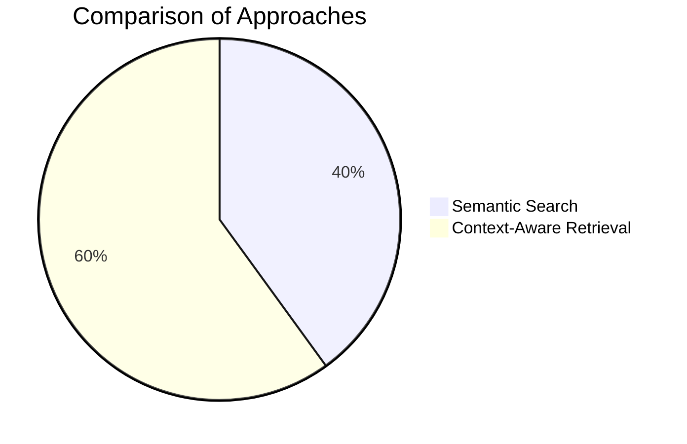

# Context-Aware Retrieval vs. Semantic Search

## Mathematical Representation

### Semantic Search

```math
S = g(Q)
```

Where:
- S = Search function output (ranked documents)
- Q = Query vector
- g = Search function

### Context-Aware Retrieval

```math
R = f(Q, C)
```

Where:
- R = Retrieval function output (relevant documents)
- Q = Query vector
- C = Context vector (previous interactions)
- f = Retrieval function

## Practical Example: E-commerce Customer Support

### Scenario

User: "I can't find my order"

### Semantic Search Approach

1. **Query Processing**:
   - Extract keywords: "order", "find", "lost"
   - Compute semantic similarity: sim(Q, D)

2. **Document Retrieval**:
   - Return pages about order tracking
   - Might miss specific order issues

```mermaid
flowchart TD
    A[User Query: "I can't find my order"] --> B[Extract Keywords]
    B --> C[Compute Semantic Similarity]
    C --> D[Return Order Tracking Pages]
```

### Context-Aware Retrieval Approach

1. **Context Integration**:
   - Consider previous interactions:
     - "I placed an order yesterday"
     - "It was a gift for my mom"
   - Understand user intent: specific order

2. **Contextual Retrieval**:
   - Retrieve documents about gift order tracking
   - Consider user's location and history

```mermaid
flowchart TD
    A[User Query: "I can't find my order"] --> B[Integrate Context]
    B --> C[Understand User Intent]
    C --> D[Retrieve Specific Order Documents]
```

## Key Differences

| Feature                | Semantic Search                     | Context-Aware Retrieval          |
|--------------------------|-----------------------------------|----------------------------------|
| Focus                  | Meaning-based retrieval           | Contextual understanding         |
| Input                  | Query only                        | Query + Context                 |
| Output                 | Document rankings                 | Relevant documents               |
| Mathematical Form      | sim(Q, D)                         | sim(Q, D | C)                    |
| Practical Use         | Information retrieval             | Conversational AI                |
| Example                | Search engine results             | Chatbot responses                |

## Implementation Implications

### Semantic Search

1. **Vector Representation**:
   - Create document embeddings
   - Store in vector database

2. **Similarity Calculation**:
   - Use cosine similarity or dot product
   - Rank documents by similarity score

### Context-Aware Retrieval

1. **Context Management**:
   - Maintain conversation history
   - Track user preferences and context

2. **Contextual Embedding**:
   - Combine query and context vectors
   - Retrieve documents based on combined embedding

## Visual Representation



## Practical Applications

1. **Customer Support Chatbots**:
   - Understand user intent in conversation
   - Provide context-aware responses

2. **Personal Assistants**:
   - Remember user preferences
   - Provide personalized recommendations

3. **Recommendation Systems**:
   - Consider user history and context
   - Provide relevant recommendations

## Resources

- [Vector Databases for Semantic Search](https://example.com/vector-databases)
- [Context-Aware Retrieval Techniques](https://example.com/context-retrieval)
- [Mathematical Foundations of Information Retrieval](https://example.com/math-ir)

## Next Steps

1. Review the mathematical and practical differences
2. Implement a simple example of each approach
3. Compare the performance of both approaches
4. Iterate based on your findings
