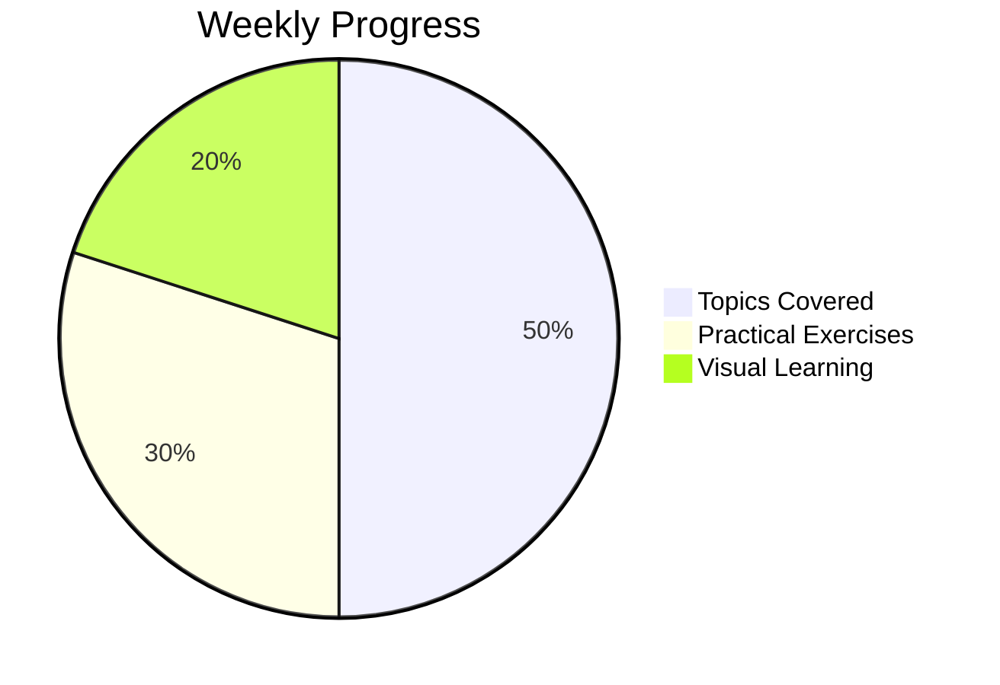

# AI Engineering Learning Journal

## Daily Learning Log

### Date: [YYYY-MM-DD]

### Topics Covered:

1. [Topic 1]
   - Key concepts learned
   - Practical examples
   - Challenges faced

2. [Topic 2]
   - Key concepts learned
   - Practical examples
   - Challenges faced

### Hands-On Practice:

1. [Project/Exercise 1]
   - Description
   - Code snippets
   - Lessons learned

2. [Project/Exercise 2]
   - Description
   - Code snippets
   - Lessons learned

### Visual Learning:

1. [Diagram/Chart 1]
   - Description
   - File location

2. [Diagram/Chart 2]
   - Description
   - File location

### Reflection:

- What worked well today?
- What challenges did I face?
- How can I improve tomorrow?

## Weekly Review

### Week [X] Summary:

- Major topics covered
- Key achievements
- Areas for improvement

### Visual Summary:

## Project Portfolio

### [Project Name]

- Description
- Technologies used
- Challenges faced
- Lessons learned
- Code repository link

### [Project Name]

- Description
- Technologies used
- Challenges faced
- Lessons learned
- Code repository link

## Resources

- [Resource 1](URL)
- [Resource 2](URL)
- [Resource 3](URL)

## Next Steps

1. [Action Item 1]
2. [Action Item 2]
3. [Action Item 3]

## Weekly Goals

- [Goal 1]
- [Goal 2]
- [Goal 3]
