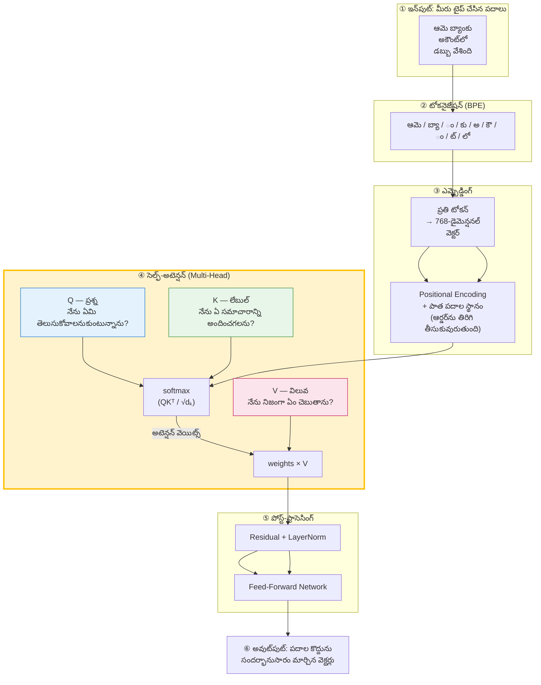
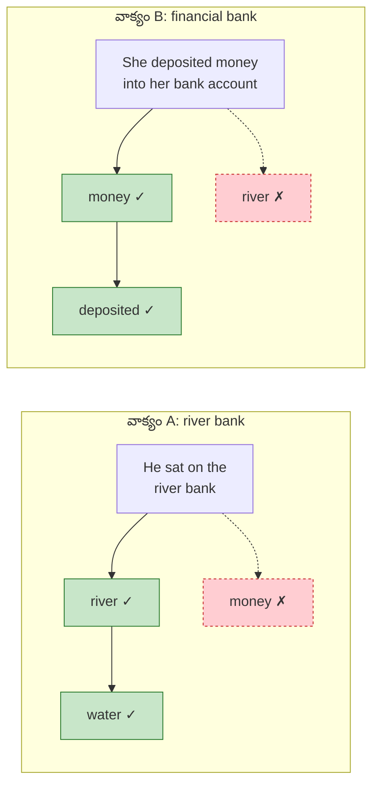
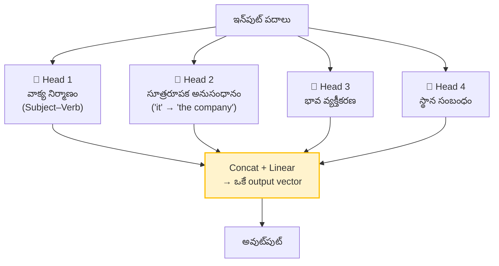
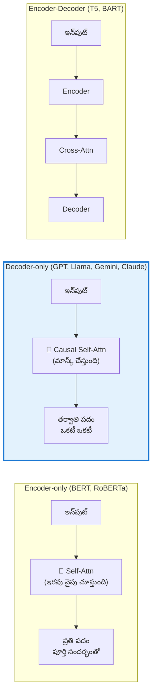

# 📘 విజువల్ గైడ్ 01: ట్రాన్స్‌ఫార్మర్ & సెల్ఫ్-అటెన్షన్ (Attention)

> **మూలం:** `Module_04_AI_Machine_Learning/Day_20_Transformers_Modern_Models` (EN + TE)
> **స్థాయి:** Level 1 → Level 3 | **పఠన సమయం:** 12 నిమిషాలు

---

## 🎯 ఈ గైడ్ లక్ష్యాలు

1. **ఆటెన్షన్ (Attention)** అంటే ఏమిటో — YouTube సెర్చ్ ఉదాహరణతో అర్థం చేసుకోవడం.
2. **Q, K, V** (Query, Key, Value) మూడు పాత్రలను ఎలా భాగ్ చేసుకుంటాయో చూడడం.
3. `softmax(QKᵀ/√dₖ)V` సూత్రాన్ని అర్థం చేసుకోవడం.
4. **Multi-Head Attention** ఎందుకు అవసరమో, **Positional Encoding** ఎలా ఆర్డర్‌ను తిరిగి తీసుకువురుతుందో తెలుసుకోవడం.
5. **Encoder-only / Decoder-only / Encoder-Decoder** మూడు architecturul మధ్య తేడా.

---

## 1. ⚡ శీఘ్ర దృశ్యం (Quick View)

```
                        ┌───────────────────────────────┐
   "బ్యాంకు" అనే పదం →   │      ATTENTION ENGINE         │
   అర్థం తెలుసుకోవడం   │                               │
                        │   Q (ప్రశ్న) ──┐               │
                        │               ├─► సimilarity │
                        │   K (లేబుల్) ──┘   score      │
                        │                               │
                        │   score → softmax → weights   │
                        │   weights × V (అర్థం) ────────┼──► contextual
                        └───────────────────────────────┘     vector
```

---

## 2. 🗺️ పూర్తి ఆర్కిటెక్చర్ (Mermaid)



---

## 3. 🧠 స్లోగానిక్: YouTube సెర్చ్ ఉదాహరణ

మీరు YouTube లో "**AI చాట్‌బాట్ ఎలా తయారు చేయాలి**" అని సెర్చ్ చేస్తున్నారు. YouTube అలా పనిచేస్తుంది:

| పాత్ర | YouTube లో | Transformer లో |
|:--|:--|:--|
| **Query (Q)** | మీరు టైప్ చేసిన సెర్చ్ స్ట్రింగ్ | ప్రశ్న పదం తనకు "ఏ సమాచారం కావాలి" అని అడుగుతుంది |
| **Key (K)** | ప్రతి వీడియో టైటిల్ + ట్యాగ్ | ప్రతి పదం తన "లేబుల్" (ఏ అర్థాన్ని కలిగి ఉంది) చెబుతుంది |
| **Value (V)** | వీడియోలోని నిజమైన కంటెంట్ | పదం నిజంగా ఏ సమాచారాన్ని లోపల దాచి ఉంది |
| **Similarity** | Q · K = రిలెవెన్స్ స్కోరు | Q · Kᵀ = అటెన్షన్ స్కోరు |
| **Output** | Top 3 వీడియోలు | ప్రతి పదం‌కు సందర్భానుసారం మార్చిన వెక్టర్ |

> 🧩 **తెలుసుకోవడానికి ఒక్క వాక్యం:**
> **"Key అంటే పేరు, Value అంటే వస్తువు."**
> పేరు (Key) సరిపోలితే, వస్తువు (Value) నిజంగా వాడతాం.

---

## 4. 🔬 "బ్యాంకు" అనే పదానికి రెండు అర్థాలు (Disambiguation)

ఒకే పదం వేర్వేరు సందర్భాలలో వేర్వేరు అర్థాలు కలిగి ఉంటుంది. ఆటెన్షన్ ఇదే ఆటోమేట్‌గా చేస్తుంది:



**అటెన్షన్ వెయిట్స్ ఎలా లెక్క అవుతాయి:**

```
అటెన్షన్ స్కోర్ = softmax( Q · Kᵀ / √dₖ )

  Q · Kᵀ   →  ప్రతి పదం × ప్రతి పదం జత → సామీప్య స్కోరు
  ÷ √dₖ    →  స్కోర్లు చాలా పెద్దగా కాకుండా చిన్నగా చేస్తుంది (gradient stability)
  softmax  →  స్కోర్లను శాతాలుగా మారుస్తుంది (మొత్తం = 1.0)
  × V      →  ఆశాల మాదిరిగా కలిపి contextual vector తయారు
```

> ⚠️ **దేనికి √dₖ?** — `dₖ` పెద్దగా ఉండగా dot product లు values చాలా పెద్దగా పెరుగుతాయి. Softmax అప్పుడు చాలా చిన్న gradients ఇస్తుంది (vanishing gradient). `√dₖ` తో వాటి variance ≈ 1 లోపల ఉండి, backpropagation స్థిరంగా ఉంటుంది.

---

## 5. 🎭 Multi-Head Attention — "అనేక మర్చులు, వేర్వేరు దృష్టికోశాలు"

ఒకే attention calculation చాలు కాదు. మోడల్ **8 నుండి 64 heads** సమాంతరంగా పనిచేస్తాయి:



| Head | ఏమి ట్రాక్ చేస్తుంది | ఉదాహరణ |
|:--|:--|:--|
| 1 | వాక్య నిర్మాణం | "రజీర **ఉద్యోగుడు**" → subject-verb |
| 2 | సూత్రరూపక అనుసంధానం | "**it** acquired **it**" → ఏ company అని నిర్ధారించడం |
| 3 | భావ వ్యక్తీకరణ | "అది **అద్భుతంగా** విజయవంతమైంది" → సానుకూలత |
| 4 | స్థాన సంబంధం | "**ముందు** రావడం" → కాలంలో ముందు |

> 🧩 **తెలుసుకోవడానికి ఒక్క వాక్యం:**
> **"Multi-Head = ఒకే పుస్తకాన్ని 8 మంది లెక్కవర్తులు చదివి, ఒక్క ఒక్క వేర్వేరు బిందువులు వెలుకుతారు."**

---

## 6. 📍 Positional Encoding — "ఆర్డర్‌ను ఎలా తెలుసుకోవాలి"

Transformer **అన్ని పదాలను ఒకేసారి (parallel) చదువుతుంది**. అందుకే అది "ఏ పదం ముందు వచ్చింది" అనే సమాచారానికి స్వయంగా వచ్చే లేదు.

```
స్థాన ఎన్‌కోడింగ్ విధానం:

  పదం:      "ఆమె"    "బ్యాంకు"   "లో"     "డబ్బు"     "వేశింది"
  స్థానం:      0        1        2        3          4
  PE:     [sin0]  [sin1]  [sin2]  [sin3]    [sin4]
          [cos0]  [cos1]  [cos2]  [cos3]    [cos4]
                  ↓  ↓  ↓  ↓
  ఇన్‌పుట్:  E(ఆమె)+PE(0), E(బ్యాంకు)+PE(1), ...

  → మోడల్‌కు "బ్యాంకు" తర్వాత "లో" వచ్చిందని తెలుస్తుంది
```

> 📌 **గుర్తుంచుకోండి:** రెండు వేర్వేరు మోడల్‌లు — **BERT** = `sin/cos` (మూడు నిర్మాణంలో సర్వలకు ముందు/వెనక్కి ఒకే విధంగా) | **GPT** = `learned` (ట్రైన్ అవుతుంది, ప్రతి పదానికి ఒక నిల్వ వెక్టర్).

---

## 7. 🏛️ మూడు Architectures



| Architecture | యాజేత | అటెన్షన్ | ఉపయోగం |
|:--|:--|:--|:--|
| **Encoder-only** | BERT, RoBERTa | Bidirectional — ఎడమ, వెలుముదురు రెండూ చూస్తుంది | Classification, Sentiment, NER, **Embeddings** |
| **Decoder-only** | GPT-4, Llama 3, Gemini, Claude | Causal (masked) — **గత పదాలను మాత్రమే** చూస్తుంది | **Text Generation**, Code, Chatbots |
| **Encoder-Decoder** | T5, BART | Encoder + Cross-Attn + Decoder | **అనువాదం**, సారాంశం |

---

## 8. ⚠️ వైఫల్యం ఎక్కడ జరుగుతుంది? (Failure Modes)

| వైఫల్యం | లక్షణం | పరిష్కారం |
|:--|:--|:--|
| **పునరావృతమైన పదాలు** | LLM ఒకే వాక్యాన్ని 3 సార్లు రాయడం | `repetition_penalty`, `frequency_penalty` సెట్ చేయండి |
| **Context window మించిన ప్రాంప్ట్ | మధ్యలోని సమాచారం మర్చిపోవడం (Lost in the Middle) | రీట్రీవల్ + సారాంశం (summarization) |
| **సరైన టోకనైజేషన్ లేకపోవడం** | తెలుగు/హిందీలో గ్లిచ్‌లు, అసంపూర్ణ పదాలు | సరైన tokenizer కొన్న **instruction-tuned** మోడల్ ఎంచుకోండి |
| **Attention స్ప్రెడ్ డ్రాప్** | చిన్న కాంటెక్స్ట్‌లో పదాల గందరగోళంగా పాడే అవకాశం | temperature ↓, top-p ↓ |

> 🧪 **ప్రాక్టికల్ చెక్:**
> ```python
> # టోకన్ కౌంట్ vs పదం కౌంట్ — ఇవి ఒకేలా కాదు!
> len("Hello world".split())              # → 2 పదాలు
> len(tokenizer.encode("Hello world"))   # → 2 tokens (ఆంగ్లంలో)
> len(tokenizer.encode("నమస్కారం"))       # → 8+ tokens (తెలుగులో!)
> ```
> బిల్లింగ్, context errors అన్నీ ఇక్కడే మొదలవుతాయి.

---

## 9. 🎤 ఇంటర్వ్యూ ప్రశ్నలు

**Q1: Transformers ఎందుకు RNN/LSTM కంటే వేగంగా ట్రెయిన్ అవుతాయి?**
**జవాబు:** RNN లో step *t* ను step *t−1* పూర్తి కాకుండా లెక్క చేయలేం — ఇది sequence parallelismను అడ్డుకుంటుంది. Transformer లో recurrence లేదు; `QKᵀ` attention matrix ద్వారా అన్ని స్థానాలను ఒకేసారి parallel GPU tensor cores మీద ప్రాసెస్ చేస్తుంది.

**Q2: `QKᵀ` ను `√dₖ` తో ఎందుకు భాగిస్తారు?**
**జవాబు:** `dₖ` పెద్దగా ఉండగా dot product లు magnitude లో పెరుగుతాయి → softmax చిన్న gradient ఇస్తుంది → vanishing gradient. `1/√dₖ` scaling వల్ల dot product variance ≈ 1 లోపల ఉండి backpropagation స్థిరంగా ఉంటుంది.

**Q3: BERT vs GPT వ్యత్యాసం ఏమిటి?**
**జవాబు:** BERT **Encoder-only** — bidirectional attention (ప్రతి పదం గతం+భవిష్యత్ రెండూ చూస్తుంది), అందుకే **అర్థం చేసుకోవడం/classification** కి ఉత్తమం. GPT **Decoder-only** — causal masked attention (ప్రతి పదం ముందు ఉన్నవాటిని మాత్రమే చూస్తుంది), అందుకే **ఆటోరెగ్రెస్సీవ్ టెక్స్ట్ generation** కి ఉత్తమం.

---

## 10. ✍️ స్వీ-చెక్ (Self-Check) — సమాధానాలు చూడకండి

1. "Bank" అనే పదం వాక్యం A, B లో వేర్వేరు అర్థాలు తీసుకుండేది — Q, K, V లో ఏది ఏ పాత్ర పోషిస్తుంది?
2. `√dₖ` లేకుండా ఉంటే ఏమి జరుగుతుంది? ఒక్క వాక్యంలో చెప్పండి.
3. Multi-Head Attention ఒకే head కంటే ఎక్కువ ఉపయోగకరంగా ఉంది ఎందుకు? (సమాధానం చూడకండి!)
4. Positional Encoding లేకుండా Transformer ఏమి తప్పుగా చేస్తుంది? ఒక్క వాక్యంలో చెప్పండి.
5. మీరు embedding task కి BERT వాడతారా GPT వాడతారా? ఎందుకు?

<details>
<summary>✅ సమాధానాలు (మీ ప్రయత్నం చేసిన తర్వాత చూడండి)</summary>

1. **K** స్వయంగా "ఏ అర్థం అనుకుంటున్నాను" అనే లేబుల్ చెబుతుంది; **V** నిజమైన సమాచారాన్ని అందిస్తుంది. Disambiguation అనేది Q ↔ K సరిపోలుదలపై ఆధారపడుతుంది.
2. Softmax చిన్న gradients ఇస్తుంది → **vanishing gradient** → శిక్షణ స్థిరంగా ఉండదు.
3. ప్రతి head వేర్వేరు అంశాన్ని ట్రాక్ చేస్తుంది (వాక్య నిర్మాణం, సూత్రరూపకం, భావం, స్థానం) → ఒకే head కంటే **మరింత పూర్తి సందర్భం** పొందుతాం.
4. పదాల **ఆర్డర్** తెలియదు → "మొదటి వాక్యం" / "ఈ తర్వాతి పదం" అనే సూచనలు అర్థం కావడం లేదు.
5. **BERT** (encoder-only) — ఇది bidirectional సందర్భంతో semantic vectors ఇస్తుంది; GPT (decoder-only) causal training కారణంగా retrieval కి అంత బలమైన representations ఇవ్వదు.

</details>

---

## 📚 తదుపరి అడుగులు

| అడుగు | పాఠం | లింక్ |
|:--|:--|:--|
| 02 | ఎమ్బెడ్డింగ్ & వెక్టర్ సెర్చ్ | [02_Embeddings_Vector_Search_TE.md](02_Embeddings_Vector_Search_TE.md) |
| 03 | RAG ఆర్కిటెక్చర్ | [03_RAG_Architecture_TE.md](03_RAG_Architecture_TE.md) |
| 04 | AI ఏజెంట్స్ (LangGraph) | [04_AI_Agent_LangGraph_TE.md](04_AI_Agent_LangGraph_TE.md) |
| 05 | MLOps CI/CD పైప్‌లైన్ | [05_MLOps_CICD_Pipeline_TE.md](05_MLOps_CICD_Pipeline_TE.md) |

⬅️ [ముఖ్య పట్టికకు వెళ్ళండి](README.md)
