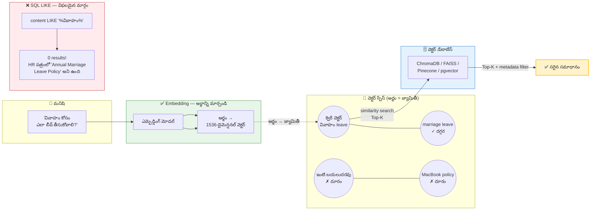
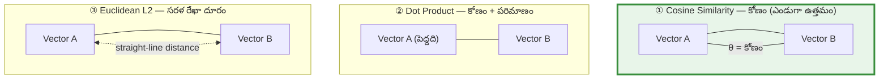
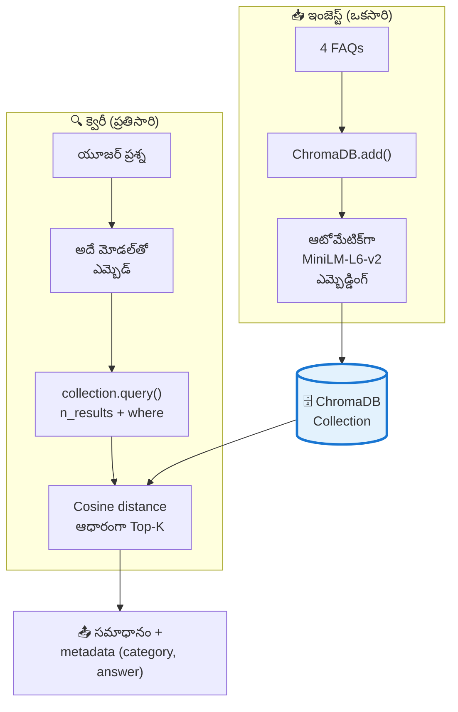
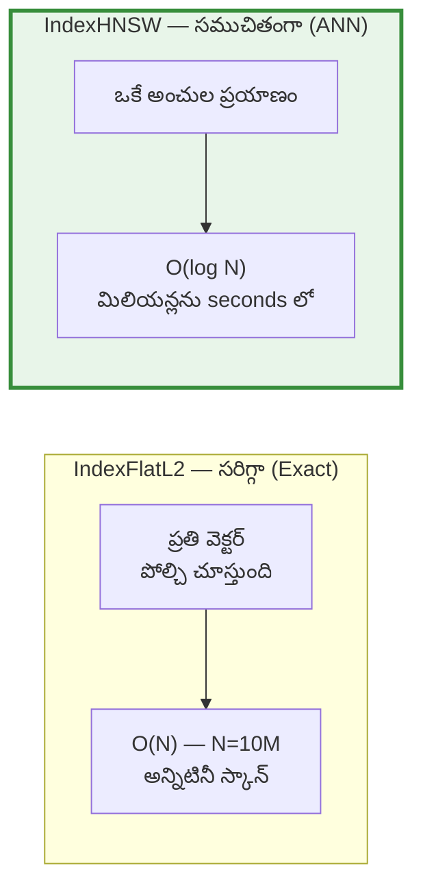

# 📘 విజువల్ గైడ్ 02: ఎమ్బెడ్డింగ్ & వెక్టర్ సెర్చ్ (Vector Search)

> **మూలం:** `Module_06_RAG_AI_Applications/Day_26_Embeddings_Vector_Search` (EN + TE)
> **స్థాయి:** Level 1 → Level 3 | **పఠన సమయం:** 12 నిమిషాలు

---

## 🎯 ఈ గైడ్ లక్ష్యాలు

1. **ఎమ్బెడ్డింగ్** అంటే భావాన్ని జ్యామితీ (geometry) లోకి మార్చడం ఎలా జరుగుతుంది.
2. **Cosine Similarity, Dot Product, Euclidean (L2)** — మూడు మెట్రిక్‌ల మధ్య తేడా, ఏది ఎప్పుడు వాడాలి.
3. SQL `LIKE '%keyword%'` ఎందుకు semantic search కి సరిపోదు.
4. **ChromaDB** (local prototyping) మరియు **FAISS** (10M+ vectors) మధ్య ఎంపిక.
5. **Metadata Filtering** ద్వారా production-grade vector search.

---

## 1. ⚡ శీఘ్ర దృశ్యం

```
  "వివాహం కోసం ఎలా లీవ్ తీసుకోవాలి?"   ← వాడుతున్న మనిషి (వేర్వేరు పదాలు)
                    │
                    ▼  Embedding Model
              ┌───────────────┐
              │  [0.21, -0.8, │  ← 1536 సంఖ్యల వెక్టర్
              │   0.45, ... ] │     (అర్థం → సంఖ్యలు)
              └───────┬───────┘
                      │
    ┌─────────────────┼─────────────────┐
    ▼                 ▼                 ▼
┌────────┐      ┌────────┐      ┌────────┐
│leave   │      │marriage│      │hardware│   ← వెక్టర్ DB
│entitle-│      │leave   │      │policy  │
│ment    │      │5 days  │      │MacBook │
└────┬───┘      └────┬───┘      └────────┘
     │  ╲           │
     │   ╲ distance │
     │    ╲         │
     ▼     ▼        ▼
   ┌─────────────────────┐
   │  Top-K: "marriage   │  ← అర్థం సరిపోలినవి ఎంచుకోవడం
   │  leave 5 days"      │
   └─────────────────────┘
```

---

## 2. 🗺️ "భావాన్ని జ్యామితీలోకి" (Mermaid)



> 🧩 **తెలుసుకోవడానికి ఒక్క వాక్యం:**
> **"Keyword search అక్షరాలను వెతుకుతుంది; Vector search భావాలను వెతుకుతుంది."**

---

## 3. 📐 మూడు సిమిలారిటీ మెట్రిక్‌లు



| మెట్రిక్ | సూత్రం | ఏమి కొలుస్తుంది | ఎప్పుడు వాడాలి |
|:--|:--|:--|:--|
| **Cosine Similarity** | `(A·B) / (\|A\|·\|B\|)` | **కోణం** (పరిమాణం పట్టించుకోకుండా). పరిధి: `[-1, 1]` | **NLP / టెక్స్ట్ ఎమ్బెడ్డింగ్‌కి డిఫాల్ట్!** |
| **Dot Product** | `A·B = Σ AᵢBᵢ` | కోణం **+** పరిమాణం | వెక్టర్లు ఇప్పటికే normalize అయ్యినప్పుడు (వేగవంతం) |
| **Euclidean (L2)** | `√Σ(Aᵢ − Bᵢ)²` | సరళ రేఖా దూరం | K-Means క్లస్టరింగ్, జ్యామితి స్థానాంశాలు |

```
   Cosine Similarity                Euclidean (L2)

        Vector A                          Vector A
          ▲                                ▲
          │ \ θ                             │  Distance (L2)
          │  \                              │ ◄──────────► Vector B
          │   \                             └────────────────────►
          └────► Vector B
```

> ⚠️ **Confusing Distance vs Similarity:**
> - Cosine **Similarity**: `1.0` = ఒకేలా (identical)
> - Cosine **Distance**: `0.0` = ఒకేలా
> ఏది మీ DB తిరిగి ఇస్తుందో తెలుసుకోండి — లేకపోతే threshold తప్పుగా పెట్టుకుంటారు!

---

## 4. 🎯 "తెలుగులో ఉన్న పదం" — సెమాంటిక్ వెక్టర్ల ఉదాహరణ

```
ఎమ్బెడ్డింగ్ మోడల్ ప్రతి పదాన్ని 1536 సంఖ్యల వెక్టర్‌గా మారుస్తుంది.
అర్థం సమీపమైన పదాలు → వెక్టర్ స్పేస్‌లో కూడా దగ్గరగా ఉంటాయి.

   Cosine Similarity ≈ 0.95   "వివాహం"  ↔  "marriage"
   Cosine Similarity ≈ 0.90   "లీవ్"    ↔  "leave entitlement"
   Cosine Similarity ≈ 0.31   "లీవ్"    ↔  "MacBook RAM"     ← దూరం

  👤 వాడుతున్న ప్రశ్న: "వివాహం కోసం ఎలా లీవ్ తీసుకోవాలి?"
     │
     │  ఒకే వాక్యంలో రెండు "అర్థాల వెక్టర్లు" కలిసినట్లు
     ▼
  🎯 వెక్టర్ DB నుండి తీసుకున్న Top-K = "Special marriage leave
     of 5 consecutive days is granted upon wedding registration."
```

### 🔢 వాస్తవ గణన (Cosine Similarity)

```python
import numpy as np

def cosine_similarity(a: np.ndarray, b: np.ndarray) -> float:
    """రెండు వెక్టర్ల మధ్య కోణం. 1.0 = ఒకే అర్థం, 0.0 = సంబంధం లేదు."""
    return float(np.dot(a, b) / (np.linalg.norm(a) * np.linalg.norm(b)))

# ఉదాహరణ: 3-డైమెన్షనల్ సరళ వెక్టర్లు (నిజమైనవి 1536-డైమెన్షనల్)
vec_wedding = np.array([0.90, 0.82, 0.75])   # "వివాహం"
vec_marriage = np.array([0.88, 0.85, 0.79])  # "marriage"
vec_hardware = np.array([0.10, 0.15, 0.05])  # "MacBook RAM"

print(cosine_similarity(vec_wedding, vec_marriage))  # → 0.995  ← దగ్గర
print(cosine_similarity(vec_wedding, vec_hardware))  # → 0.115  ← దూరం
```

---

## 5. 🗄️ ChromaDB — Local Vector Database



```python
import chromadb

client = chromadb.Client()

# Collection = SQL Table లాంటిది
faq_collection = client.create_collection(
    name="ecommerce_faqs",
    metadata={"hnsw:space": "cosine"}   # ← cosine space ఎంచుకోండి!
)

faq_entries = [
    {"id": "faq_01", "q": "How to request a refund for a damaged item?",
     "ans": "Go to Orders > Return Item and upload photos within 48 hours."},
    {"id": "faq_02", "q": "Why was I billed multiple times for a single order?",
     "ans": "Duplicate charges are pending authorization holds released in 3-5 business days."},
    {"id": "faq_03", "q": "How do I change my shipping address?",
     "ans": "Address can be modified in Orders tab if item has not dispatched."},
]

faq_collection.add(
    documents=[e["q"] for e in faq_entries],
    metadatas=[{"answer": e["ans"]} for e in faq_entries],
    ids=[e["id"] for e in faq_entries],
)

def resolve_customer_query(customer_question: str, max_distance_threshold: float = 0.5):
    results = faq_collection.query(query_texts=[customer_question], n_results=1)
    distance = results["distances"][0][0]
    matched_q  = results["documents"][0][0]
    answer     = results["metadatas"][0][0]["answer"]

    print("="*55)
    print(f"Customer Query: '{customer_question}'")
    print(f"Closest FAQ   : '{matched_q}'")
    print(f"Distance Score: {distance:.4f}")
    if distance > max_distance_threshold:
        print("⚠️ ROUTING TO HUMAN: No matching FAQ found with high confidence.")
    else:
        print(f"✅ AUTO-RESOLUTION: {answer}")
    print("="*55)

# ✅ సెమాంటిక్ డూప్లికేట్ — పదాలు ఒకేలా లేనా సరిపోతుంది
resolve_customer_query("I see two identical debit deductions for one purchase.")
# ⚠️ అసంబద్ధమైన ప్రశ్న — తిరస్కరించాలి
resolve_customer_query("What is the recipe for chocolate chip cookies?")
```

---

## 6. ⚡ FAISS — 10 Million Vectors కి



```python
import numpy as np, faiss

dimension = 4
num_vectors = 1000
np.random.seed(42)
document_vectors = np.random.random((num_vectors, dimension)).astype("float32")

index = faiss.IndexFlatL2(dimension)
index.add(document_vectors)
print(f"FAISS Index ready with {index.ntotal} vectors.")

query_vector = np.random.random((1, dimension)).astype("float32")
distances, indices = index.search(query_vector, 3)
print("\nTop 3 Nearest Document Indices:", indices[0])
print("L2 Distances to Query:", distances[0])
```

| | ChromaDB | FAISS |
|:--|:--|:--|
| **ఏమిటి** | Full-featured vector DB (API + persistence) | Library (C++ + AVX-512 + GPU) |
| **వేగం** | మధ్యస్థం | **అత్యంత వేగం** |
| **అంతరం** | Built-in (ChromaDB local) / Pinecone (cloud) | **మీ సర్వర్‌లోనే** |
| **మీకు కావాలి** | Prototyping, RAG MVP | **10M+ vectors, latency-critical** |

---

## 7. ⚠️ వైఫల్యం ఎక్కడ జరుగుతుంది?

| వైఫల్యం | లక్షణం | పరిష్కారం |
|:--|:--|:--|
| 🔴 **వేర్వేరు ఎమ్బెడ్డింగ్ మోడల్ల‌ల మిక్స్** | ఇంజెస్ట్ `text-embedding-3-small` (1536), క్వెరీ Gemini → **సమాధానం ఎప్పటికీ రాదు** | **ఇంగెస్ట్ + క్వెరీ రెండింటికీ ఒకే మోడల్** |
| 🔴 **Metadata ని విస్మరించడం** | సాధారణ పదాలు ఉన్న ఇంజినీరింగ్ డాక్స్ కూడా వస్తాయి | `where={"department": "finance"}` ఫిల్టర్ |
| 🟡 **Distance vs Similarity తప్పు** | threshold తప్పుగా → అన్నీ తిరస్కరిస్తుంది లేదా అన్నీ అప్రూవ్ చేస్తుంది | DB డాక్స్ చదవండి |
| 🟡 **స్పెస్ misconfiguration** | `hnsw:space` లేకుండా → cosine vs L2 తప్పు | collection సృష్టించేటప్పుడే సెట్ చేయండి |
| 🟡 **Top-K చాలా పెద్దది** | 20 chunks → ప్రాంప్ట్ నాకిరీస్, సమాధానం గందరగోళం | 3–5 chunks |

> 💡 **Curse of Dimensionality:** డైమెన్షన్లు పెరిగే కొద్దీ (1536, 3072) స్పేస్ volume గణనీయంగా పెరుగుతుంది, అన్ని పాయింట్లు దాదాపు సమ దూరంలో కనిపిస్తాయి → L2 ఏమి వేరుచేయలేదు. అందుకే **Cosine (కోణం)** వాడాలి.

---

## 8. 🎤 ఇంటర్వ్యూ ప్రశ్నలు

**Q1: Curse of Dimensionality అంటే ఏమిటి, ఎమ్బెడ్డింగ్‌లో ఎలా సంబంధం?**
**జవాబు:** డైమెన్షన్లు పెరిగే కొద్దీ స్పేస్ volume గణనీయంగా పెరుగుతుంది → డేటా పాయింట్లు అత్యంత విలీనంగా (sparse) మారతాయి → Euclidean distance తన విభేదన శక్తిని కోల్పోతుంది (అన్నీ సమ దూరంలో కనిపిస్తాయి). అందుకే అధిక డైమెన్షన్లలో **Cosine Similarity (కోణం)** ఎంచుకుంటారు.

**Q2: HNSW అంటే ఏమిటి?**
**జవాబు:** HNSW (Hierarchical Navigable Small World) అనే **graph-based indexing algorithm**. పైన, మధ్య, కింది — అనేక పొరల **skip-list graph** ను వెక్టర్లతో నిర్మిస్తుంది. ANN (Approximate Nearest Neighbor) సెర్చ్‌కు O(log N) సమయంలో మిలియన్ల వెక్టర్లను స్కాన్ చేస్తుంది (O(N) brute-force కంటే).

**Q3: వేర్వేరు మోడల్‌ల ఎమ్బెడ్డింగ్‌లను పోల్చవెసుకోవెసుకోలేం ఎందుకు?**
**జవాబు:** ప్రతి ఎమ్బెడ్డింగ్ మోడల్‌కు వేర్వేరు neural architecture, tokenizer vocabulary, loss function ఉంటాయి — అందుకే ప్రతి మోడల్ తన సొంత **coordinate latent space** లో భావాలను వెతుకుతుంది. వేర్వేరు మోడల్ వెక్టర్లను పోల్చడం = GPS (latitude/longitude) కోఆర్డినేట్లను TV స్క్రీన్ పిక్సెల్ కోఆర్డినేట్లతో పోల్చడం — ఉమ్మడి భూ-చట్టం లేదు.

---

## 9. ✍️ స్వీ-చెక్ (సమాధానాలు చూడకండి)

1. "wedding" పదం HR పత్రంలో లేదు, కానీ RAG దాన్ని తెలుసుకుందింది. ఇది ఏ metric వల్ల సాధ్యమైంది? ఎందుకు dot product కంటే cosine మేర్చి?
2. Ingest A మోడల్, query B మోడల్. ఏమి జరుగుతుంది? ఒక్క వాక్యం.
3. Cosine similarity = 0.85 వచ్చింది. ఈ వెక్టర్ ఎంత దూరంలో ఉందో చెప్పగలరా? ఎందుకు?
4. Metadata filter లేకుండా 500-page HR manual నుండి top-5 తీసుకుంటే ఏమి జరుగుతుంది?
5. FAISS vs ChromaDB — 50 లక్షల వెక్టర్ల కోసం ఏది ఎంచుకుంటారు? ఎందుకు?

<details>
<summary>✅ సమాధానాలు</summary>

1. **Cosine similarity** — ఇది భావం (అర్థం) ఆధారంగా లెక్కిస్తుంది, అక్షరాల గుర్తింపు ఆధారంగా కాదు. Cosine వెక్టర్ **కోణాన్ని** పరిశీలిస్తుంది — vector magnitude (పదం పరిమాణం) దేనినీ పట్టించుకోకుండా. Dot product magnitude ను కూడా జోడిస్తుంది, అందుకే పదం పరిమాణం వేరైనప్పుడు noise గా చేరుతుంది.
2. **ఎప్పటికీ ముందు ఉన్న వెక్టర్లు వెనక్కి కనిపిస్తాయి** (మూడు రకాలు: రిట్రీవల్ ఖాళీ, లేదా dimension mismatch error). వేర్వేరు models వేర్వేరు latent spaces → cross-model comparison అర్థం లేదు.
3. **లేదు.** Cosine similarity ఒక *సంబంధం* (సారీపత) మాత్రమే — అసలు దూరం తెలుసుకోవడానికి **Euclidean distance** కావాలి. (వాస్తవానికి చాలా vector DBs లో cosine distance = `1 − cosine_similarity` అని ఇస్తాయి.)
4. **అసంబద్ధమైన chunks వస్తాయి** — ప్రతి page లో కొన్ని జనరల్ పదాలు (leave, benefits, policy) ఉంటాయి, అవి ప్రతిచోటే కనిపిస్తాయి. LLM అప్పుడు 5 పేజీలను చూసి **అసంపూర్ణ/తప్పు సమాధానం** ఇస్తుంది. `where={"department": "hr"}` ఫిల్టర్ ఉపయోగించండి.
5. **FAISS** — 50 లక్షల వెక్టర్లు, sub-100ms latency అవసరమైతే FAISS (HNSW) అన్నిటికంటే వేగంగా, memory-efficient. ChromaDB అనేక విషయాల్లో (persistence, metadata filtering, built-in embeddings) సౌఖ్యం, కానీ scale లో FAISS తెలుగా వేగం.

</details>

---

## 📚 తదుపరి అడుగులు

| అడుగు | పాఠం | లింక్ |
|:--|:--|:--|
| 01 | ట్రాన్స్‌ఫార్మర్ & ఆటెన్షన్ | [01_Transformer_Attention_TE.md](01_Transformer_Attention_TE.md) |
| 03 | RAG ఆర్కిటెక్చర్ | [03_RAG_Architecture_TE.md](03_RAG_Architecture_TE.md) |
| 04 | AI ఏజెంట్స్ (LangGraph) | [04_AI_Agent_LangGraph_TE.md](04_AI_Agent_LangGraph_TE.md) |
| 05 | MLOps CI/CD పైప్‌లైన్ | [05_MLOps_CICD_Pipeline_TE.md](05_MLOps_CICD_Pipeline_TE.md) |

⬅️ [ముఖ్య పట్టికకు వెళ్ళండి](README.md)
