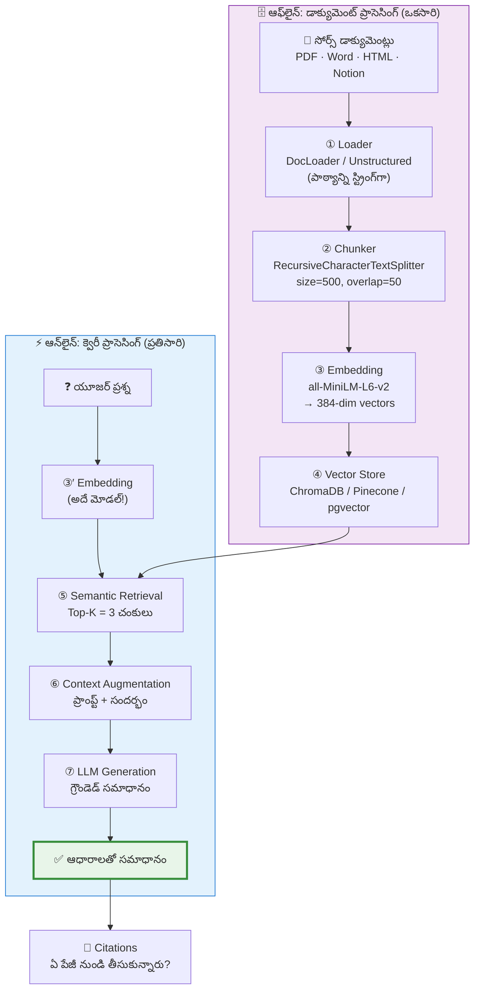
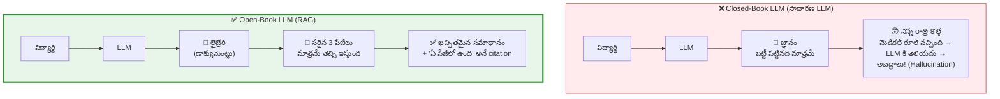

# 📘 విజువల్ గైడ్ 03: RAG ఆర్కిటెక్చర్ (Retrieval-Augmented Generation)

> **మూలం:** `Module_06_RAG_AI_Applications/Day_27_RAG_Architecture` (EN + TE)
> **స్థాయి:** Level 1 → Level 3 | **పఠన సమయం:** 15 నిమిషాలు

---

## 🎯 ఈ గైడ్ లక్ష్యాలు

1. **RAG** అంటే ఏమిటి — closed-book vs open-book LLM తేడా.
2. **7 దశలు** — డాక్యుమెంట్ ఇంజెస్ట్ నుండి ఖచ్చితమైన సమాధానం వరకు.
3. **Chunk Size vs Chunk Overlap** వెనుక ఉన్న లాజిక్.
4. **Grounding Prompt** — అబద్ధాలు ఆపే విధానం.
5. Framework లేకుండా Python లో మొదటి RAG పైప్‌లైన్.

---

## 1. ⚡ శీఘ్ర దృశ్యం

```
┌─────────────── ఆఫ్‌లైన్ (ఒకసారి మాత్రమే) ───────────────┐
│                                                          │
│  [PDF/Word/HTML] → [టెక్స్ట్] → [చంకులు] → [ఎమ్బెడ్డింగ్] → [వెక్టర్ DB] │
│                                                          │
└──────────────────────────────────────────────────────────┘
                              ║
                              ║  (ఆఫ్‌లైన్ ↔ ఆన్‌లైన్ విభజన)
                              ║
┌─────────────────── ఆన్‌లైన్ (ప్రతి ప్రశ్నకు) ──────────┐
│                                                          │
│  [ప్రశ్న] → [ఎమ్బెడ్] → [సెర్చ్] → [Top-K చంకులు] → [ప్రాంప్ట్] → [LLM] → [✅] │
│                                                          │
└──────────────────────────────────────────────────────────┘
```

---

## 2. 🗺️ పూర్తి 7 దశలు (Mermaid)



> 🧩 **తెలుసుకోవడానికి ఒక్క వాక్యం:**
> **"RAG = మోడల్‌కి ఓపెన్-బుక్ ఇవ్వడం."**
> పరీక్షలో ముందు మీరు ఓపెన్-బుక్‌ను అడగాలి; RAG ఆ ఓపెన్-బుక్ నుండి సరైన 3 పేజీలు తెచ్చి ఇస్తుంది.

---

## 3. 🏫 Closed-Book vs Open-Book



| | Closed-Book LLM | Open-Book LLM (RAG) |
|:--|:--|:--|
| **జ్ఞానం** | బట్టీ పట్టినవి మాత్రమే | మీ డాక్యుమెంట్లు (ప్రతి ప్రశ్నకు తేజ‌ ప్రత్యేకంగా) |
| **అప్‌డేట్** | మోడల్ రీ-ట్రెయిన్ అవ్వాలి | **డాక్యుమెంట్ రీ-ఇంజెస్ట్ చేస్తే సరిపోతుంది** |
| **Hallucination** | తరచు | చాలా తక్కువ (grounding వల్ల) |
| **Citation** | లేదు | ✅ ఉంది — ఏ డాక్యుమెంట్ నుండి తీసుకున్నారో |
| **ఖర్చు** | Context ఖర్చు లేదు | Retrieval + పెద్ద context → **ఖర్చు ఎక్కువ** |

---

## 4. ✂️ చంకింగ్: Chunk Size & Overlap

### ❌ ఒక్క 50-పేజీ PDF ను ఒకే వెక్టర్‌గా?

**కాదు.** ఒకే వెక్టర్‌గా మారిస్తే లోపలి చిన్న విషయాలు కలిసిపోయి అస్పష్టంగా మారతాయి.

### ✅ సరైన విధానం: 500–800 అక్షరాల చంకులు + 10% ఓవర్‌ల్యాప్

```
మూల వాక్యం:
"కంపెనీ ఉద్యోగుల వార్షిక బోనస్ ఎప్పుడు ఇస్తారంటే, కంపెనీ తన లాభాల
టార్గెట్‌ను చేరుకున్నప్పుడు మాత్రమే ఇస్తారు."

   ◄──────── chunk_size = 50 ────────►
   ┌──────────────────────────┐
   │ "...కంపెనీ ఉద్యోగుల వార్షిక బోనస్  │  ← 1వ చంక్
   │  ఎప్పుడు ఇస్తారంటే,..."              │
   └──────────────────────────┘
                 ┌──────────────────────────┐
        overlap →│ "...ఎప్పుడు ఇస్తారంటే, కంపెనీ తన లాభాల │  ← 2వ చంక్
          = 10  │  టార్గెట్‌ను చేరుకున్నప్పుడు మాత్రమే ఇస్తారు."│
                 └──────────────────────────┘

   ⚠️ ఓవర్‌ల్యాప్ లేకుండా → రెండు చంకుల్లోనూ పూర్తి సత్యం ఉండదు
   ✅ ఓవర్‌ల్యాప్ తో   → వాక్యం రెండు చంకుల్లోనూ సంపూర్ణంగా ఉంటుంది
```

```python
def split_document(text: str, chunk_size: int = 250, overlap: int = 50) -> list[str]:
    """పాఠ్యాన్ని ఓవర్‌ల్యాప్ తో చంకులుగా విడదీస్తుంది."""
    chunks = []
    start = 0
    while start < len(text):
        chunk = text[start:start + chunk_size].strip()
        if len(chunk) > 20:          # చాలా చిన్న/noise చంకులు వద్దు
            chunks.append(chunk)
        start += (chunk_size - overlap)   # ← ఓవర్‌ల్యాప్ కావాలి!
    return chunks
```

| Chunk Size | వర్ణం |
|:--|:--|
| **50 అక్షరాలు** (చాలా చిన్న) | వాక్యం అర్థం మారిపోతుంది, వెక్టర్లు చాలా |
| **500–800 అక్షరాలు** ✅ | **ఉత్తమ స్వీట్ స్పాట్** |
| **5000 అక్షరాలు** (చాలా పెద్ద) | సమాధానం అనవసరపు పదాల మధ్య దాగిపోతుంది, LLM "lost in the middle" అవుతుంది |

> 🧩 **తెలుసుకోవడానికి ఒక్క వాక్యం:**
> **"Overlap అంటే వాక్యం మధ్యలో తెగిపోకుండా రెండు చంకుల్లోనూ ఉండేలా చేసే బెల్ట్."**

---

## 5. 🛡️ Grounding Prompt — అబద్ధాలు ఆపే శిల్పం

```python
GROUNDED_RAG_PROMPT_TEMPLATE = """
నువ్వు కంపెనీ అసిస్టెంట్‌వి. కింద <context> లో ఇచ్చిన సమాచారం ఆధారంగా
మాత్రమే ప్రశ్నకు సమాధానం ఇవ్వు.

<rules>
1. సమాధానం ఈ డాక్యుమెంట్లలో లేకపోతే:
   "ఈ సమాచారం నాకు ఇచ్చిన డాక్యుమెంట్లలో లేదు" అని మాత్రమే చెప్పు.
2. నీ సొంత ఊహలు, అబద్ధాలు అస్సలు రాయవద్దు.
3. ప్రతి సమాధానానికి ఏ డాక్యుమెంట్ నుండి తీసుకున్నావో ఆధారం చెప్పు.
</rules>

<context>
{తీసుకొచ్చిన_డాక్యుమెంట్_ముక్కలు}
</context>

<user_question>
{యూజర్_అడిగిన_ప్రశ్న}
</user_question>
"""
```

```
Prompt యొక్క మూడు స్తంభాలు:

   ┌──────────────┬──────────────────┬──────────────┐
   │  ROLE        │  RULES            │  CONTEXT     │
   │  "నువ్వు      │  ① లేకపోతే       │  <context>   │
   │  అసిస్టెంట్‌వి" │  ② అబద్ధాలు వద్దు │  ...         │
   │              │  ③ citation చెప్పు │  </context>  │
   └──────────────┴──────────────────┴──────────────┘
                              │
                     ┌────────┴────────┐
                     │  <user_question> │
                     └─────────────────┘
```

> 📌 **Grounding ≠ ప్రామాణికంగా సరైనది.** Grounding అంటే "మీరు చెప్పినది మీ డాక్యుమెంట్‌లో ఉంది" అని నిర్ధారించడమే — డాక్యుమెంట్‌లోని సమాచారం సరిగ్గా ఉందో అదే వేరు. అందుకే **RAG evaluation** (faithfulness, relevance) అవసరం.

---

## 6. 💻 Framework లేకుండా మొదటి RAG పైప్‌లైన్

```python
# =========================================================
# Day 27 Lab: ఎండ్-టు-ఎండ్ RAG పైప్‌లైన్
# =========================================================
import chromadb
from google import genai
from google.genai import types

COMPANY_POLICY_DOC = """
టీచిన్ గ్లోబల్ ఎంప్లాయ్ హ్యాండ్‌బుక్ (2026 ఎడిషన్)
విభాగం 1: ల్యాప్‌టాప్ & హోమ్ ఆఫీస్ అలవెన్స్
ప్రతి ఉద్యోగికి ఇంటి వద్ద ఆఫీస్ సెటప్ కోసం ₹1,50,000 అలవెన్స్ ఇవ్వబడుతుంది.
ప్రతి 24 నెలలకు ఒకసారి హార్డ్‌వేర్ అప్‌గ్రేడ్ చేసుకోవచ్చు.

విభాగం 2: ఆరోగ్యం మరియు వెల్‌నెస్ ప్రయోజనాలు
పూర్తి స్థాయి ఉద్యోగుల కుటుంబానికి ₹10,00,000 వరకు హెల్త్ ఇన్సూరెన్స్ వర్తిస్తుంది.
అదనంగా మానసిక ఆరోగ్యం మరియు కౌన్సిలింగ్ కోసం సంవత్సరానికి ₹25,000
వెల్‌నెస్ స్టైపెండ్ లభిస్తుంది.

విభాగం 3: పేరెంటల్ లీవ్ (సంతాన సెలవులు)
తల్లులకు 26 వారాల పూర్తి జీతంతో కూడిన సెలవులు లభిస్తాయి.
తండ్రులకు 6 వారాల పూర్తి జీతంతో కూడిన సెలవులు ఉంటాయి.
"""

# 1. చంకింగ్
def split_document(text: str, chunk_size: int = 250, overlap: int = 50) -> list[str]:
    chunks = []
    start = 0
    while start < len(text):
        chunk = text[start:start + chunk_size].strip()
        if len(chunk) > 20:
            chunks.append(chunk)
        start += (chunk_size - overlap)
    return chunks

chunks = split_document(COMPANY_POLICY_DOC)
print(f"డాక్యుమెంట్ నుండి {len(chunks)} చంకులు తయారు చేయబడ్డాయి.")

# 2. ChromaDB లో స్టోర్
chroma_client = chromadb.Client()
policy_collection = chroma_client.create_collection("techin_handbook")

policy_collection.add(
    documents=chunks,
    metadatas=[{"source": "Employee_Handbook_2026.pdf",
                 "chunk_id": f"chunk_{i}"} for i in range(len(chunks))],
    ids=[f"id_{i}" for i in range(len(chunks))],
)

# 3. RAG క్వెరీ పైప్‌లైన్
def query_rag_pipeline(user_query: str):
    results = policy_collection.query(query_texts=[user_query], n_results=2)
    retrieved_texts = results["documents"][0]
    context_block = "\n---\n".join(retrieved_texts)

    prompt = f"""
    కేవలం కింద ఇచ్చిన సమాచారం ఆధారంగా మాత్రమే ప్రశ్నకు సమాధానం ఇవ్వు.
    సమాచారం లేకపోతే: "ఈ సమాచారం హ్యాండ్‌బుక్‌లో లేదు" అని చెప్పు.

    <context>
    {context_block}
    </context>

    ప్రశ్న: {user_query}
    """

    gemini_client = genai.Client()
    response = gemini_client.models.generate_content(
        model="gemini-1.5-flash",
        contents=prompt,
        config=types.GenerateContentConfig(temperature=0.0),   # ← 0.0 = deterministic
    )

    print("\n" + "="*55)
    print(f"యూజర్ ప్రశ్న : {user_query}")
    print(f"డేటాబేస్ నుండి వచ్చిన సమాచారం:\n{context_block}")
    print("\nAI నిజాయితీతో కూడిన సమాధానం:")
    print(response.text.strip())
    print("="*55)

# ✅ డాక్యుమెంట్‌లో ఉన్న ప్రశ్న
query_rag_pipeline("మానసిక ఆరోగ్యం కోసం కంపెనీ ఎంత డబ్బులు ఇస్తుంది?")

# ⚠️ డాక్యుమెంట్‌లో లేని ప్రశ్న — సున్నితంగా తిరస్కరించాలి!
query_rag_pipeline("ఆఫీస్‌కి పెంపుడు కుక్కలను తీసుకురావచ్చా?")
```

---

## 7. ⚠️ వైఫల్యం ఎక్కడ జరుగుతుంది?

| వైఫల్యం | లక్షణం | పరిష్కారం |
|:--|:--|:--|
| 🔴 **వెక్టర్ DB నుండి వచ్చినదాన్ని ఫిల్టర్ చేయకుండా LLM కి పంపడం** | సంబంధం లేని సమాచారం వచ్చినప్పుడు → LLM నిజంగా అబద్ధాలు చెబుతుంది | `n_results=2..3`, అవసరమైతే similarity threshold |
| 🔴 **Chunk size చాలా చిన్నది/పెద్దది** | వాక్యం టूట్టు పడటం లేదా సమాధానం దాగిపోవడం | 500–800 అక్షరాలు, 10% overlap |
| 🔴 **Citations చూపించకపోవడం** | యూజర్‌కు విశ్వాసం లేదు, fact-check చేయలేడు | metadata లో `source` + `chunk_id` ను LLM కి చూపించు |
| 🟡 **Ingest/Query లో వేర్వేరు embedding మోడల్** | వెక్టర్లు సరిపోకపోవడం → ఫలితం లేదు | **ఒకే మోడల్, ఒకే dimension** |
| 🟡 **Temperature ≠ 0** | ఒకే ప్రశ్నకు రెండు సార్లు వేర్వేరు సమాధానాలు | RAG సమాధానాలకు `temperature=0.0` |
| 🟡 **మీరు RAG ను బదిలీ చేస్తున్నారా?** | క్వెరీ డాక్యుమెంట్‌లో ఉన్నా LLM అబద్ధాలు చెబుతుంది | → Hybrid search + reranking + eval |

---

## 8. 🎤 ఇంటర్వ్యూ ప్రశ్నలు

**Q1: Chunk Overlap ఎందుకు అవసరం?**
**జవాబు:** చంకింగ్ చేసేటప్పుడు ఒక వాక్యం లేదా అర్థవంతమైన ఆలోచన మధ్యలో తెగిపోకుండా కాపాడటానికి. ఒక చంక్ చివర ఉన్న సమాచారాన్ని తర్వాతి చంక్ ప్రారంభంలో మళ్లీ పునరావృతం చేయడం వల్ల రెండు పక్కపక్క చంకుల్లోనూ సందర్భం చెడిపోకుండా ఉంటుంది.

**Q2: RAG లో Hallucination ని ఎలా తగ్గిస్తారు?**
**జవాబు:** Base model గతంలో నేర్చుకున్న విషయాలను గుర్తించడంలో విఫలమై అబద్ధాలు చెబుతాయి. RAG ప్రశ్న రాగానే బయటి నమ్మకమైన డేటాబేస్ నుండి అసలు డాక్యుమెంట్ పేరాగ్రాఫులను తీసుకొచ్చి మోడల్‌కి ఇస్తుంది; system prompt ద్వారా "కేవలం ఈ ఆధారాలతో మాట్లాడు" అని కట్టడు చేస్తుంది; temperature 0 ఉంచుతుంది. అయితే **grounding ≠ ప్రామాణిక సరైనది** — దానికి RAG evaluation అవసరం.

**Q3: Dense vs Sparse retrieval తేడా?**
**జవాబు:** **Dense** — న్యూరల్ ఎమ్బెడ్డింగ్‌ల ద్వారా భావం (meaning) ఆధారంగా వెతుకుతుంది ("కారు" ↔ "వాహనం"). **Sparse** (BM25) — ఖచ్చితమైన అక్షరాలు/పదాల ఫ్రీక్వెన్సీ ఆధారంగా వెతుకుతుంది ("పార్ట్ నంబర్ #AB-9021" లాంటి ఖచ్చితమైన ID కోసం). ఆధునిక RAG లో రెండింటినీ కలిపి **hybrid search** వాడతారు.

---

## 9. ✍️ స్వీ-చెక్ (సమాధానాలు చూడకండి)

1. ఆఫ్‌లైన్ దశలు మరియు ఆన్‌లైన్ దశలు వేరుగా ఎందుకు ఉంటాయి? ఒక్క కారణం చెప్పండి.
2. Chunk size 5000 చేస్తే ఏమి జరుగుతుంది? "Lost in the middle" అంటే ఏమిటి?
3. మీరు Top-K = 50 చంకులు తీసుకుంటే ఏమి జరుగుతుంది? రెండు దశలు చెప్పండి (ఖర్చు + ఖాదరీ).
4. Grounding prompt ఇచ్చినా LLM ఇప్పటికీ అబద్ధాలు చెప్పగలదా? ఎందుకు?
5. "రెండు దశల్లో వేర్వేరు embedding models" — దీని వల్ల ఏమి జరుగుతుంది?

<details>
<summary>✅ సమాధానాలు</summary>

1. **ఖర్చు + లేటెన్సీ.** ఆఫ్‌లైన్ ఎంబెడ్డింగ్ ఖర్చుకూడా ఎక్కువ (ప్రతి డాక్యుమెంట్ చంకు). ఆన్‌లైన్‌లో మాత్రమే embedding చేయాలంటే ప్రతి ప్రశ్నకు పూర్తి డాక్యుమెంట్ మార్చాలి → అన్యాయమైన లేటెన్సీ. ఆఫ్‌లైన్‌లో చేసి store చేస్తే query time లో vector lookup మాత్రమే.
2. సమాధానం అనవసరపు పదాల మధ్య దాగిపోతుంది; LLM ప్రారంభ, మధ్య, చివరి పదాలకు అసలు ఎక్కువ శ్రద్ధ పెట్టుతుంది, మధ్య దాదాపు విస్మరిస్తుంది — అదే "Lost in the Middle" ఫిజిజు.
3. **(ఖర్చు)** పెద్ద context → ప్రతి ప్రశ్నకు ఎక్కువ tokens → ఖర్చు పెరుగుతుంది. **(ఖాదరీ)** 50 చంకుల్లో 47 irrelevant → LLM సరైన 3 ను వాడలేకపోతుంది → hallucination పెరుగుతుంది.
4. **అవును.** Grounding అంటే "మీరు చెప్పినది మీరు ఇచ్చిన డాక్యుమెంట్‌లో ఉంది" అనే నిర్ధారణ మాత్రమే. డాక్యుమెంట్‌లో **తప్పు/obsolete సమాచారం** ఉంటే (కాలం చెల్లిన పాలసీ), శిక్షించబడిన LLM దానినే నిజమైనదిగా చెబుతుంది. అందుకే doc freshness + eval అవసరం.
5. **వెక్టర్లు సరిపోవడం లేదు.** వేర్వేరు మోడల్ల వేర్వేరు latent space → dimension కూడా వేర్వేరు (1536 vs 768) → dimension mismatch error లేదా dimension ఒకే అయితే భావం చెడిపోతుంది. **ఇంగెస్ట్ + క్వెరీ రెండింటికీ ఒకే మోడల్.**

</details>

---

## 📚 తదుపరి అడుగులు

| అడుగు | పాఠం | లింక్ |
|:--|:--|:--|
| 01 | ట్రాన్స్‌ఫార్మర్ & ఆటెన్షన్ | [01_Transformer_Attention_TE.md](01_Transformer_Attention_TE.md) |
| 02 | ఎమ్బెడ్డింగ్ & వెక్టర్ సెర్చ్ | [02_Embeddings_Vector_Search_TE.md](02_Embeddings_Vector_Search_TE.md) |
| 04 | AI ఏజెంట్స్ (LangGraph) | [04_AI_Agent_LangGraph_TE.md](04_AI_Agent_LangGraph_TE.md) |
| 05 | MLOps CI/CD పైప్‌లైన్ | [05_MLOps_CICD_Pipeline_TE.md](05_MLOps_CICD_Pipeline_TE.md) |

⬅️ [ముఖ్య పట్టికకు వెళ్ళండి](README.md)
