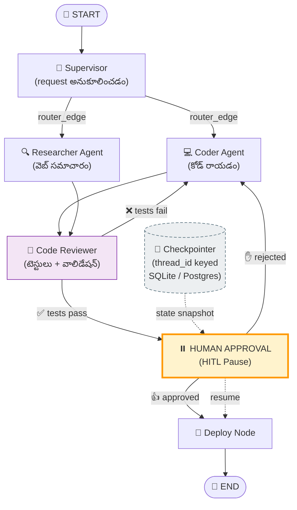
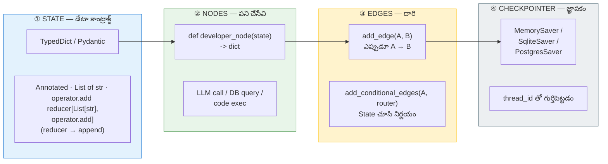
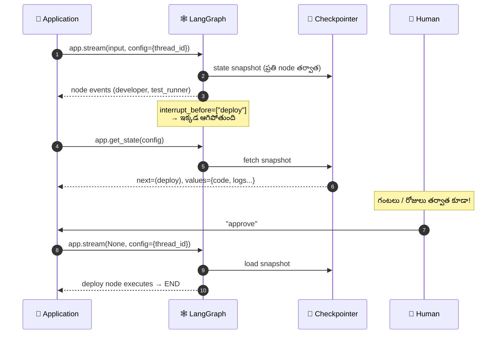
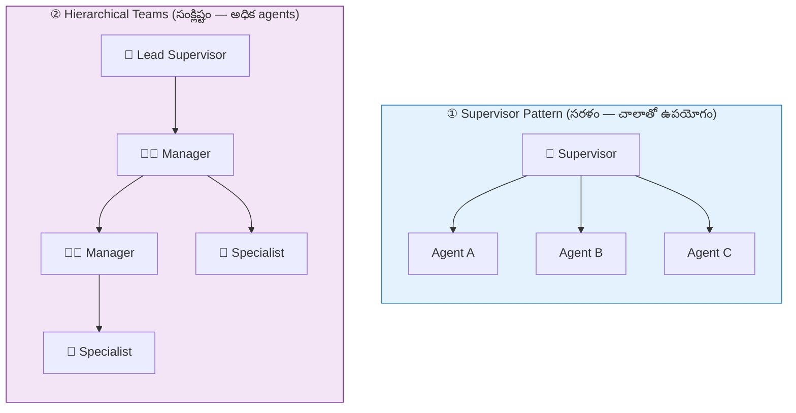

# 📘 విజువల్ గైడ్ 04: AI ఏజెంట్స్ & LangGraph (State, Nodes, Edges, HITL)

> **మూలం:** `Module_07_Agentic_AI_MCP/Day_31_LangGraph_Agents` (EN + TE)
> **స్థాయి:** Level 2 → Level 4 | **పఠన సమయం:** 15 నిమిషాలు

---

## 🎯 ఈ గైడ్ లక్ష్యాలు

1. **Stateful graph** ఎందుకు rigid linear chain కంటే మెరుగు — ER (ఎమర్జెన్సీ రూమ్) ఉదాహరణ.
2. LangGraph నాలుగు ప్రధాన building blocks: **State, Nodes, Edges, Checkpointers**.
3. **Human-in-the-Loop (HITL)** — ఎప్పుడు మనిషి ఆమోదం అవసరం, అది పనిచేయడం ఎలా.
4. **Supervisor vs Hierarchical** multi-agent patterns.
5. **Circuit breaker** — infinite loop ను ఎలా ఆపాలి.

---

## 1. ⚡ శీఘ్ర దృశ్యం

```
   🏭 LINEAR CHAIN (LangChain)          🏥 STATEFUL GRAPH (LangGraph)
   ─────────────────────────────         ───────────────────────────────
   బottle → wash → fill → cap → label    START → Supervisor ──┬─→ Coder
                    ↑                                │        └─→ Researcher
                    └── cracked? గుర్తించలేదు            ↓
              (backwards పోలేదు!)              Code Reviewer
                                                    │
                                       tests pass? ──┴── No → (మళ్లీ Coder)
                                                    │ Yes
                                                    ↓
                                              ⏸️ HUMAN APPROVAL
                                                    ↓
                                                  END
```

---

## 2. 🗺️ పూర్తి ఆర్కిటెక్చర్ (Mermaid)



---

## 3. 🏥 ER ఉదాహరణ — State, Nodes, Edges, HITL

| LangGraph భాగం | ER లో | అర్థం |
|:--|:--|:--|
| **State** | రోగి చార్ట్ (vitals, symptoms, notes) | ప్రతి node కు షేర్ చేసే డేటా |
| **Node** | వైద్యుడు | State ను ఇన్‌పుట్‌గా తీసుకుని, State మార్పులను రిటర్న్ చేస్తాడు |
| **Normal Edge** | విభాగానికి రిఫరల్ | ఎప్పుడూ తర్వాతి విభాగానికి |
| **Conditional Edge** | ట్రయాజ్ నర్సు నిర్ణయం | State చూసి ఎక్కడికి పంపాలో నిర్ణయం |
| **Checkpoint** | మెడికల్ రికార్డు | ప్రతి దశలో స్థితి సేవ్ → తర్వాత రెండవసారి మొదలెప్పడం, time-travel |
| **HITL** | సీనియర్ డాక్టర్ సంతకం | అధికార ఆమోదం లేకుండా ముందుకు వెళ్ళదు |

> 🧩 **తెలుసుకోవడానికి ఒక్క వాక్యం:**
> **"LangChain = conveyor belt (ముందుకే వెళ్ళాలి), LangGraph = ER flowchart (ఎప్పుడైనా ఎక్కడైనా వెళ్ళొచ్చు)."**

---

## 4. 🧱 నాలుగు Building Blocks



### ① State — ముఖ్యం: Reducer!

```python
import operator
from typing import Annotated, TypedDict, Literal, List

class AgentState(TypedDict):
    task: str
    code: str
    test_passed: bool
    iterations: int
    human_approved: bool
    # ↓ Annotated + reducer = "జోడించు" (overwrite కాదు!)
    logs: Annotated[List[str], operator.add]
```

> ⚠️ `logs: List[str]` (reducer లేకుండా) రాస్తే — ప్రతి node తన log తో మొత్తం list ను **overwrite** చేస్తుంది → మీరు చివరి node log మాత్రమే చూస్తారు. `operator.add` reducer వల్ల **append** అవుతుంది.

### ③ Edges — Normal vs Conditional

```python
workflow.add_edge(START, "developer")              # Normal: ఎప్పుడూ
workflow.add_edge("developer", "test_runner")      # Normal: ఎప్పుడూ

workflow.add_conditional_edges(
    "test_runner",
    routing_logic,                                # Conditional: State చూసి
    {
        "developer": "developer",                  #   టెస్ట్ fail → మళ్లీ డెవలపర్
        "human_approval": "deploy",               #   పాస్ → deploy (అయితే అక్కడే pause)
        "__end__": END,                           #   retry limit → ఆపు
    },
)
```

---

## 5. 🛑 Circuit Breaker — Infinite Loop ని ఆపడం

```python
def routing_logic(state: AgentState) -> Literal["developer", "human_approval", "__end__"]:
    """టెస్ట్ స్టేటస్, retry limit ఆధారంగా తదుపరి node ని నిర్ణయిస్తుంది."""
    if state["test_passed"]:
        return "human_approval"

    if state["iterations"] >= 3:
        return "__end__"      # 🔌 CIRCUIT BREAKER — లంటె లంటె ఆగండి!

    return "developer"         # ↩️ లూప్: మళ్లీ సరిచేయించు
```

```
  iterations:  0 → 1 → 2 → 3
                 │   │   │   │
                 ▼   ▼   ▼   ▼
              dev test dev test dev test
                                 │
                    iterations >= 3 ──→ __end__  🛑

  ⚠️ ఈ breaker లేకుండా: LLM ప్రతిసారీ failing code ఇస్తే graph అనంతరం తిరిగుతుంది
     → API credits కరిగిపోతాయి + infinite loop.
```

---

## 6. ⏸️ Human-in-the-Loop — ఎలా పనిచేస్తుంది?



```python
from langgraph.graph import StateGraph, END, START
from langgraph.checkpoint.memory import MemorySaver

workflow = StateGraph(AgentState)
workflow.add_node("developer", developer_node)
workflow.add_node("test_runner", test_runner_node)
workflow.add_node("deploy", deploy_node)

workflow.add_edge(START, "developer")
workflow.add_edge("developer", "test_runner")
workflow.add_conditional_edges(
    "test_runner", routing_logic,
    {"developer": "developer", "human_approval": "deploy", "__end__": END},
)
workflow.add_edge("deploy", END)

memory = MemorySaver()
app = workflow.compile(
    checkpointer=memory,
    interrupt_before=["deploy"],        # ⏸️ deploy ముందు ఆగు
)

thread_config = {"configurable": {"thread_id": "session-101"}}

# ── Phase 1: HITL వరకు నడుస్తుంది ──
for event in app.stream(initial_input, config=thread_config):
    for node_name, output in event.items():
        print(f"[{node_name}] -> {output.get('logs', [''])[0]}")

snapshot = app.get_state(thread_config)
print("⏸️ GRAPH HAS PAUSED!")
print(f"Next scheduled node: {snapshot.next}")
print(f"Current verified code:\n{snapshot.values['code']}")

# ── Phase 2: మనిషి ఆమోదం → రజుమా ──
human_choice = "approve"
if human_choice == "approve":
    for event in app.stream(None, config=thread_config):     # ← None = state నుండి రిజుమ్
        for node_name, output in event.items():
            print(f"[{node_name}] -> {output.get('logs', [''])[0]}")
```

> 🔑 **HITL యొక్క నిజమై శక్తి:** `app.stream(None, ...)` — ప్రారంభ స్థితి నుండి మళ్లీ ప్లే చేయనవసరం లేదు. **Checkpoint నుండి ఎక్కడ ఆగిందో అక్కడే కొనసాగుతుంది.** ఆమోదం వచ్చేవరకు వెంటే గంటలు/రోజులు గడగడగా.

### 🛡️ HITL ఎప్పుడు అవసరం?

| ప్రమాదం | ఉదాహరణ | HITL |
|:--|:--|:--|
| 💰 ఆర్థిక | బ్యాంక్ ట్రాన్స్ఫర్, రిఫండ్ | ✅ తప్పనిసరి |
| 📧 ప్రజా సంబంధం | యూజర్‌కు ఇమెయిల్ పంపడం | ✅ శిలంగా |
| 🗑️ డేటా తొలగింపు | రికార్డు డిలీట్ | ✅ తప్పనిసరి |
| 📊 read-only | రిపోర్ట్ రీడ్ చేయడం | ❌ అవసరం లేదు |

---

## 7. 🤝 Multi-Agent Patterns



| | Supervisor | Hierarchical |
|:--|:--|:--|
| **ఎవరు నిర్ణయిస్తారు** | ఒకే Supervisor అన్ని agents ను route చేస్తాడు | Lead → Manager → Specialist |
| **అనుకూలం** | సులభం, debug చేయడం సులభం, చిన్న సిస్టమ్‌లకు | పెద్ద, విభిన్న సంక్లిష్టమైన పనులకు |
| **అంతటి వైఫల్యం** | Supervisor నుండి ఒకటి fail అయితే అంతా ఆగుతుంది | **ఒకే agent fail అయినా మిగతా వాటికి ప్రభావం ఉండదు** |

---

## 8. ⚠️ వైఫల్యం ఎక్కడ జరుగుతుంది?

| వైఫల్యం | లక్షణం | పరిష్కారం |
|:--|:--|:--|
| 🔴 **State list overwrite** | ప్రతి node తన log మాత్రమే — history లేదు | `Annotated[List[str], operator.add]` |
| 🔴 **Infinite graph cycle** | LLM ప్రతిసారీ failing code → loop → credits కరిగిపోతాయి | `iterations` counter + circuit breaker |
| 🔴 **`thread_id` లేకుండా `get_state()`** | `NotFoundError` / state చూడలేకపోవడం | `config={"configurable": {"thread_id": "..."}}` |
| 🔴 **HITL లేకుండా production deploy** | లోపమైన code productionకు | `interrupt_before` తప్పనిసరి |
| 🟡 **స్థిరమైన sub-graph** | Sub-graph లో error → పూర్తి graph గాడిదు | `subgraph=False` తో state isolation |
| 🟡 **రిట్రై లేని API కాల్** | transient error → workflow గాడిదు | node-level retry policy |

---

## 9. 🎤 ఇంటర్వ్యూ ప్రశ్నలు

**Q1: LangChain SequentialChains కంటే LangGraph ఎందుకు?**
**జవాబు:** Sequential chains **DAG** — అంటే loops, branching, dynamic persistence లేవు. Production AI workflows కి cycles (స్వీ-కరెక్షన్, code retry), state rollbacks, గంటల పాటు human approval pause కావాలి. LangGraph గణనను **state machine** గా చూస్తుంది — nodes ఒక shared state dict ను అప్‌డేట్ చేస్తాయి, edges conditional మరియు cyclic కూడా కావచ్చు, built-in checkpointing ఉంటుంది.

**Q2: HITL అంతర్గతంగా ఎలా పనిచేస్తుంది?**
**జవాబు:** Checkpointing (`MemorySaver` / `SqliteSaver` / `PostgresSaver`) ఉపయోగిస్తారు. `interrupt_before=["node"]` సెట్ చేస్తే, compiled graph ఆ node చేరే ముందు control ని caller కి తిరిగి ఇస్తుంది, state ను `thread_id` తో keyed checkpointer లో serialize చేస్తుంది. ఆపplication వెబ్ UI/API ద్వారా గంటలు/రోజుల పాటు human approval వాచిస్తుంది; ఆమోదం తర్వాత `app.stream(None, config={"configurable": {"thread_id": "..."}})` తో **అక్కడే నుండి** రిజుమ్ అవుతుంది.

**Q3: Reducers యొక్క ఉద్దేశ్యం ఏమిటి?**
**జవాబు:** డిఫాల్ట్‌గా node `{"count": 5}` తిరిగి ఇస్తే LangGraph state లోని పాత విలువను **overwrite** చేస్తుంది. Reducers (`Annotated[Type, reducer_fn]`) ఎలా కలపాలో చెబుతాయి — `operator.add` లేదా custom merge. Chat conversation లేదా event log లో మాత్రమే గత మessages append చేయాలంటే ఇది అవసరం.

---

## 10. ✍️ స్వీ-చెక్ (సమాధానాలు చూడకండి)

1. `logs: List[str]` (reducer లేకుండా) vs `Annotated[List[str], operator.add]` — వాటి మధ్య ఏ తేడా? ఒక్క వాక్యం.
2. HITL pause అయ్యిన తర్వాత, 3 రోజుల తర్వాత ఆమోదం వచ్చింది — state ఇంకా ఉందా? ఎలా నిలుస్తుంది?
3. Circuit breaker లేకుండా ఏమి జరుగుతుంది? రెండు నష్టాలు చెప్పండి.
4. Supervisor pattern, hierarchical teams కంటే ఎప్పుడు మెరుగు? ఎప్పుడు తక్కువ?
5. HITL ఎక్కడ తప్పనిసరి? ఒక్క ప్రశ్న ఇవ్వండి.

<details>
<summary>✅ సమాధానాలు</summary>

1. **Reducer లేకుండా** — ప్రతి node తన log list తో state లోని `logs` ను overwrite చేస్తుంది → చివరి node log మాత్రమే మిగులుతుంది. **Reducer తో** — `operator.add` ప్రతి node log ను append చేస్తుంది → పూర్తి history ఉంటుంది.
2. **అవును, state పూర్తిగా ఉంటుంది.** Checkpointer (SQLite/Postgres) లో `thread_id` తో keyed వద్ద serialize అయినే ఉంటుంది. ఆమోదం వచ్చిన తర్వాత `app.stream(None, config)` పిలిస్తే checkpoint నుండి **అక్కడే కొనసాగుతుంది** — మధ్యలో process గంటలు ఆపినా ప్రభావం ఉండదు.
3. **① API credits కరిగిపోతాయి** (ఇన్నిఫనైట్ loop లో ప్రతి iteration ఒక LLM call). **② Cost + latency అనియంత్రణ లేకుండా పెరుగుతుంది**, చెదురుమందుగా errors వెనక్కి అడ్డుకుని ఉంటాయి. **③ Node limit / recursion limit** తెలియని state ని చెడిపోయిన state నుండి rescue చేయలేం.
4. **Supervisor మెరుగు:** agentల సంఖ్య తక్కువ (2–5), అన్ని agents కీ ఒకే domain సంబంధం, debugging సులభం కావాలి, ఒకే Supervisor ప్రతి routing ని నిర్ణయించాలి. **Hierarchical మెరుగు:** agentల సంఖ్య ఎక్కువ, విభిన్న సబ్-టాస్క్‌లు, ఒక agent fail అయినా మిగతా వాటి పని కొనసాగాలి.
5. **ఆర్థిక లేదా డేటా-సంబంధిత చర్యలు** — బ్యాంక్ ట్రాన్స్ఫర్, రిఫండ్ ఇవ్వడం, రికార్డు డిలీట్ చేయడం, ఉత్పత్తి సర్వర్‌కు deploy చేయడం. అలాగే GDPR/PII కంటెంట్ కంట్రోల్ చేసే డేటా.

</details>

---

## 📚 తదుపరి అడుగులు

| అడుగు | పాఠం | లింక్ |
|:--|:--|:--|
| 03 | RAG ఆర్కిటెక్చర్ | [03_RAG_Architecture_TE.md](03_RAG_Architecture_TE.md) |
| 05 | MLOps CI/CD పైప్‌లైన్ | [05_MLOps_CICD_Pipeline_TE.md](05_MLOps_CICD_Pipeline_TE.md) |
| 01 | ట్రాన్స్‌ఫార్మర్ & ఆటెన్షన్ | [01_Transformer_Attention_TE.md](01_Transformer_Attention_TE.md) |

⬅️ [ముఖ్య పట్టికకు వెళ్ళండి](README.md)
