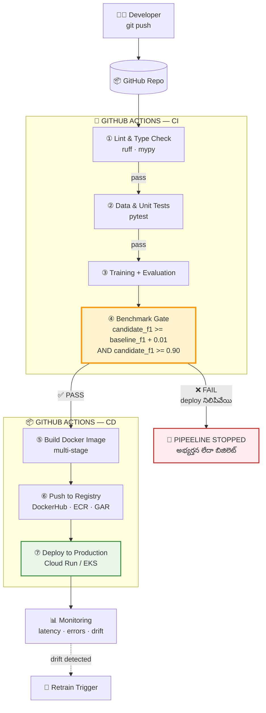
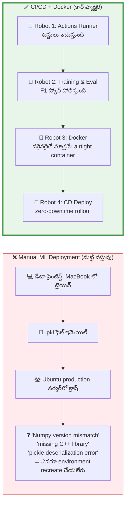
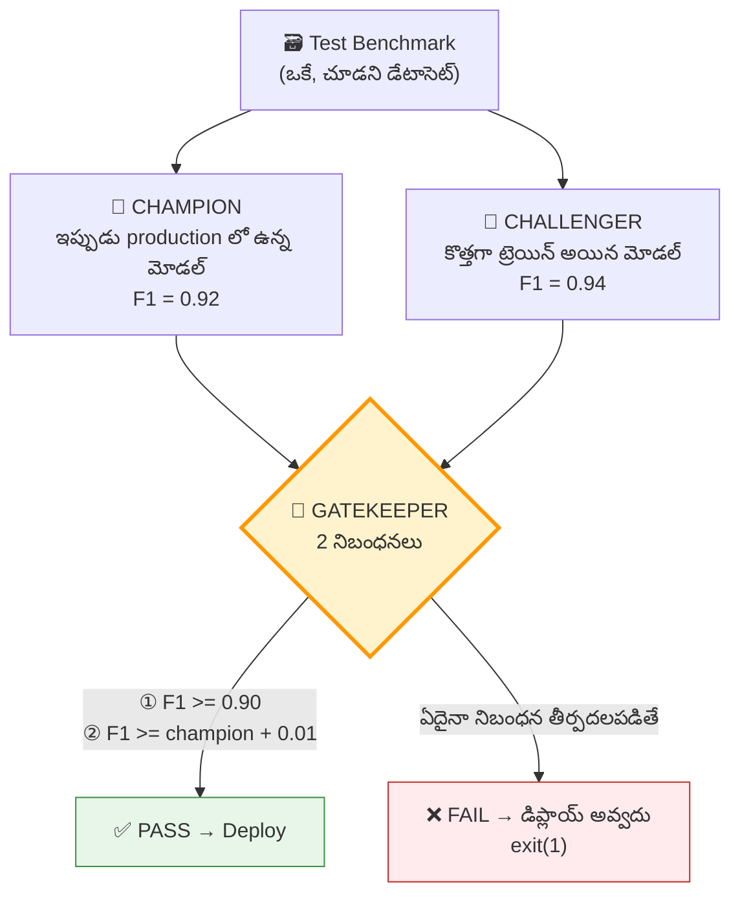
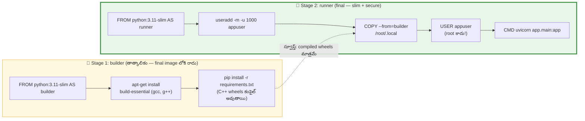

# 📘 విజువల్ గైడ్ 05: MLOps CI/CD పైప్‌లైన్ (Champion–Challenger)

> **మూలం:** `Module_08_MLOps_LLMOps/Day_34_ML_Pipelines_CICD` (EN + TE)
> **స్థాయి:** Level 2 → Level 5 | **పఠన సమయం:** 15 నిమిషాలు

---

## 🎯 ఈ గైడ్ లక్ష్యాలు

1. **ML CI/CD పైప్‌లైన్** — code push నుండి production deploy వరకు 7 దశలు.
2. **Champion–Challenger** వ్యూహం — నిజమైన model gate ఎలా పనిచేస్తుంది.
3. **Multi-stage Dockerfile** — 4GB image ను 250MB లోకి తీసుకువడం.
4. **GitHub Actions** workflow — lint → test → benchmark → build → publish.
5. సాధారణ ML deployment లోపాలు — అవి ఎలా ధర్మణీయ వైఫల్యాలకు దారి తీస్తాయి.

---

## 1. ⚡ శీఘ్ర దృశ్యం

```
 Developer
    │ git push
    ▼
┌───────────────┐   ┌──────────────────────────────────────┐
│  GitHub Repo  │──▶│  GitHub Actions CI/CD Runner          │
└───────────────┘   │  ① Lint → ② Test → ③ Benchmark Gate   │
                    │  ④ Docker Build → ⑤ Push to Registry   │
                    └──────────────────┬───────────────────┘
                                       │ gate PASS అయితే మాత్రమే
                                       ▼
                            ┌─────────────────────────────┐
                            │  Production (Cloud Run/EKS)  │
                            └─────────────────────────────┘
```

---

## 2. 🗺️ పూర్తి పైప్‌లైన్ (Mermaid)



---

## 3. 🏭 "మట్టి మట్టి వస్తువు" vs "ఆటోమేటిక్ కార్ ఫ్యాక్టరీ"



---

## 4. 🏆 Champion–Challenger వ్యూహం



```python
# evaluate_and_gatekeep.py
"""
CI/CD Gatekeeper: candidate vs baseline.
Exit 0 = candidate qualifies · Exit 1 = candidate rejected.
"""
import sys
from sklearn.datasets import load_breast_cancer
from sklearn.model_selection import train_test_split
from sklearn.metrics import f1_score
from sklearn.ensemble import RandomForestClassifier

def evaluate_models():
    data = load_breast_cancer()
    X_train, X_test, y_train, y_test = train_test_split(
        data.data, data.target, test_size=0.2, random_state=42
    )

    # 👑 Champion — ఇప్పుడు production లో ఉన్నది
    baseline_model = RandomForestClassifier(n_estimators=10, max_depth=2, random_state=42)
    baseline_model.fit(X_train, y_train)
    baseline_f1 = f1_score(y_test, baseline_model.predict(X_test))

    # 🥊 Challenger — కొత్త ట్రెయిన్ చేసినది
    candidate_model = RandomForestClassifier(n_estimators=50, max_depth=5, random_state=42)
    candidate_model.fit(X_train, y_train)
    candidate_f1 = f1_score(y_test, candidate_model.predict(X_test))

    print(f"Current Production Baseline F1: {baseline_f1:.4f}")
    print(f"New Candidate Challenger F1  : {candidate_f1:.4f}")

    # 🛡️ Governance rules
    MINIMUM_ABSOLUTE_F1 = 0.90    # స్వీటమైన కనీసం ఉండాలి
    IMPROVEMENT_DELTA   = 0.01    # champion కంటే ఎంత ఎక్కువ ఉండాలి

    if candidate_f1 < MINIMUM_ABSOLUTE_F1:
        print(f"❌ CI FAILED: Candidate F1 ({candidate_f1:.4f}) below floor of {MINIMUM_ABSOLUTE_F1}")
        sys.exit(1)

    if candidate_f1 < (baseline_f1 + IMPROVEMENT_DELTA):
        print(f"⚠️ CI REJECTED: Candidate does not improve baseline by {IMPROVEMENT_DELTA*100}% margin.")
        sys.exit(1)

    print("✅ CI PASSED: Candidate model surpasses baseline! Proceeding to packaging & deploy.")
    sys.exit(0)

if __name__ == "__main__":
    evaluate_models()
```

> 🧩 **తెలుసుకోవడానికి ఒక్క వాక్యం:**
> **"బెట్టర్ కోడ్ రాస్తే కాదు — బెట్టర్ గుర్తులు (F1, AUC, latency) కొలిచి అప్పుడు అనుమతి ఇస్తాం."**

---

## 5. 🐳 Multi-Stage Dockerfile — 4GB → 250MB



```dockerfile
# Stage 1: Build dependencies
FROM python:3.11-slim AS builder
WORKDIR /app
RUN apt-get update && apt-get install -y --no-install-recommends \
    build-essential \
    && rm -rf /var/lib/apt/lists/*
COPY requirements.txt .
RUN pip install --user --no-cache-dir -r requirements.txt

# Stage 2: Final lightweight runtime
FROM python:3.11-slim AS runner
WORKDIR /app
RUN useradd -m -u 1000 appuser          # 🔐 non-root user
COPY --from=builder /root/.local /home/appuser/.local
COPY app/ /app/app/
COPY models/ /app/models/
ENV PATH=/home/appuser/.local/bin:$PATH
ENV PYTHONUNBUFFERED=1
USER appuser                            # 🔐 root కాదు!
EXPOSE 8000
CMD ["uvicorn", "app.main:app", "--host", "0.0.0.0", "--port", "8000"]
```

```
  Single-stage:  [python + gcc + g++ + build-essential + deps + app]  ≈ 4 GB 🐘
  Multi-stage:   [python slim + wheels + app]                          ≈ 250 MB 🐇

  లాభాలు: చిన్న image → fast cold start, తక్కువ attack surface, తక్కువ storage
```

---

## 6. ⚙️ GitHub Actions Workflow

```yaml
# .github/workflows/ml_pipeline.yml
name: ML Pipeline CI/CD

on:
  push:
    branches: [ "main" ]
  pull_request:
    branches: [ "main" ]

jobs:
  test_and_evaluate:
    runs-on: ubuntu-latest
    steps:
      - name: Checkout Code
        uses: actions/checkout@v4

      - name: Set up Python
        uses: actions/setup-python@v5
        with:
          python-version: "3.11"
          cache: "pip"

      - name: Install Dependencies
        run: |
          python -m pip install --upgrade pip
          pip install -r requirements.txt
          pip install ruff pytest

      - name: Code Quality & Linting
        run: |
          ruff check .

      - name: Run Unit Tests
        run: |
          pytest tests/

      - name: Run Model Benchmark Gatekeeper
        run: |
          python evaluate_and_gatekeep.py

  build_and_publish_docker:
    needs: test_and_evaluate          # ← మునుపటి job PASS అయితేనే
    if: github.ref == 'refs/heads/main' && github.event_name == 'push'
    runs-on: ubuntu-latest
    steps:
      - name: Checkout Code
        uses: actions/checkout@v4
      - name: Set up Docker Buildx
        uses: docker/setup-buildx-action@v3
      - name: Build Container Image
        run: |
          docker build -t my-ml-service:${{ github.sha }} .
          echo "Docker image built successfully for commit ${{ github.sha }}"
```

```
  Event: git push to main
      │
      ▼
  ┌──────────────────────────────────────────┐
  │ job: test_and_evaluate                   │
  │  ruff → pytest → evaluate_and_gatekeep   │
  └───────────────────┬──────────────────────┘
         PASS ✅       │        FAIL ❌
                      │          └─→ ⛔ ఇక్కడే ఆపు (deploy కాదు)
                      ▼
  ┌──────────────────────────────────────────┐
  │ job: build_and_publish_docker            │
  │  needs: test_and_evaluate                │
  │  docker build → push to registry         │
  └──────────────────────────────────────────┘
```

---

## 7. 🔌 Serving Layer — FastAPI

```python
# app/main.py
from fastapi import FastAPI, HTTPException
from pydantic import BaseModel, Field
import numpy as np

app = FastAPI(title="ML Production Serving API", version="1.0.0")

class InferenceRequest(BaseModel):
    features: list[float] = Field(..., example=[14.2, 20.5, 92.4, 654.1, 0.086])

class InferenceResponse(BaseModel):
    prediction: int
    confidence: float

@app.get("/health")
def health_check():
    return {"status": "HEALTHY", "model_version": "v1.2.0"}

@app.post("/predict", response_model=InferenceResponse)
def predict(request: InferenceRequest):
    if len(request.features) != 5:
        raise HTTPException(status_code=400, detail="Expected exactly 5 numerical features.")
    score = float(np.mean(request.features) / 1000.0)
    pred = 1 if score > 0.05 else 0
    return {"prediction": pred, "confidence": min(round(score, 4), 1.0)}
```

---

## 8. ⚠️ వైఫల్యం ఎక్కడ జరుగుతుంది?

| వైఫల్యం | ఉత్పత్తి దుర్వారానికి కారణం | Best Practice |
|:--|:--|:--|
| 🔴 **Docker `root`గా రన్** | FastAPI లో vulnerability ఉంటే attacker కి host node పై **root** ప్రాప్య | `USER appuser` తప్పనిసరి |
| 🔴 **Unpinned dependencies** | `pandas` (కాదు `pandas==2.2.1`) → 2 నెలల తర్వాత breaking change → CI బిగ్గరిస్తుంది | `pip freeze` / `uv.lock` / `poetry.lock` |
| 🔴 **Silent data leakage** | Training set లో evaluate చేయడం, లేదా split చేయడానికి ముందు full dataset మీద scaler fit చేయడం | Scaler/transformers ను **కేవలం `X_train` మీద** fit చేయి; `X_test` ను transform మాత్రమే చేయి |
| 🟡 **Gatekeeper లేకుండా deploy** | చెడ్డ మోడల్ productionకు | Benchmark gate తప్పనిసరి |
| 🟡 **Image tag = `latest`** | ఏది deploy అయ్యిందో తెలియదు → rollback అసాధ్యం | `my-ml-service:${github.sha}` వాడండి |
| 🟡 **Health check లేకుండా rollout** | Bad image traffic తీసుకుంటుంది | `/health` endpoint + readiness probe |

> 🧪 **Data leakage ప్రాక్టికల్ చెక్:**
> ```python
> # ❌ తప్పు — information leak
> scaler.fit(X)                       # full dataset!
> X_train, X_test = train_test_split(X, y)
>
> # ✅ సరైనది
> X_train, X_test = train_test_split(X, y, random_state=42)
> scaler.fit(X_train)                 # train మీదే
> X_test_t = scaler.transform(X_test) # test ను transform మాత్రమే
> ```

---

## 9. 🎤 ఇంటర్వ్యూ ప్రశ్నలు

**Q1: CI/CD లో "Champion–Challenger" వ్యూహం అంటే ఏమిటి?**
**జవాబు:** ఇప్పుడు deploy అయిన **Champion** మోడల్ vs కొత్తగా ట్రెయిన్ అయిన **Challenger** మోడల్ ను **ఒకే చూడని test benchmark** మీద పోలిస్తారు. పైప్‌లైన్ strict gates ఆరోపిస్తుంది — Challenger production కు promote అవ్వడానికి pre-configured margin (ఉదా +1% F1) తో Champion ని అధిగమించాలి, అలాగే latency, fairness వంటి critical secondary metrics వెనక్కి తగ్గకూడదు.

**Q2: Python ML యాప్‌లకు multi-stage Docker builds ఎందుకు అవసరం?**
**జవాబు:** Python ML packages కి C/C++ compilation tools (`gcc`, `g++`, `make`) కావాలి. Single-stage Dockerfile లో ఈ heavy compilers final image లోనే మిగిలిపోతాయి → image size GB ల పెరుగుతుంది, attack surface పెరుగుతుంది. Multi-stage build లో `builder` stage లో compile చేసి, final clean wheels మాత్రమే slim `runner` image లోకి copy చేస్తుంది → build size, cold-start latency గణనీయంగా తగ్గుతాయి.

**Q3: Model training మొదలయ్యే ముందు ML CI pipeline లో ఏ టెస్టులు రావాలి?**
**జవాబు:**
1. **Linting & Type Checking** — Ruff, Mypy (syntax, typing errors).
2. **Data Schema Validation** — input features సరైన టైప్‌లా, missing value threshold, category cardinality (Great Expectations / Pydantic).
3. **Unit Tests on Feature Transforms** — one-hot encoding, log scaling, imputation ఇలాంటి mathematical transformations డిటర్మినిస్టిక్, non-null output ఇస్తాయో టెస్ట్.

---

## 10. ✍️ స్వీ-చెక్ (సమాధానాలు చూడకండి)

1. Single-stage vs multi-stage Docker build — image size తప్పుతో పాటు మరో రెండు ప్రయోజనాలు ఏమిటి?
2. Gatekeeper లో `candidate_f1 >= 0.90` మరియు `candidate_f1 >= baseline + 0.01` రెండూ ఎందుకు ఉండాలి? ఒక్కటి మాత్రమే ఉంటే ఏమి జరుగుతుంది?
3. `scaler.fit(X)` (full dataset) vs `scaler.fit(X_train)` — వ్యత్యాసం ఏమిటి? ఏది సరైనది?
4. `latest` tag వాడకపోవడానికి కారణం? మరో tag నెమ్ముదు చెప్పండి.
5. Pipeline లో `needs:` ఉంటే ఏమి జరుగుతుంది? అది లేకుండా ఏమి జరుగుతుంది?

<details>
<summary>✅ సమాధానాలు</summary>

1. **ఫలితాలు:** (ఖ) **Security** — compilers/tools లేకుండా attack surface తగ్గుతుంది; (స) **Cold start** — చిన్న image = faster container start = quicker scale-up, scale-down. (మరోది: **Layer caching** — build stages cache అయ్యేలా.)
2. రెండూ కావాలి ఎందుకంటే — `>= 0.90` **స్వీటమైన కనీసం** ఇస్తుంది (మరింత మెచ్చుకోగా మోడల్ కూడా వద్దు), `>= baseline + 0.01` **ప్రగతిని** బిల్డ్ చేస్తుంది. ఒక్కటి మాత్రమే ఉంటే: `0.90` మాత్రమే ఉంటే — champion కంటే చెడ్డదైనా deploy అవుతుంది; `baseline+0.01` మాత్రమే ఉంటే — champion బలహీనమైతే కొత్తదానికి గేట్ అవుతుంది.
3. **`scaler.fit(X)`** అంటే scaling parameters (mean, std) **test data నుండి కూడా** చూస్తాయి → అదే test సమాచారం model కి చెప్పబడింది → **data leakage** → ప్రభావంగా F1 artificially పెరుగుతుంది, production లో performance దెబ్బతీరు. **సరైనది** `scaler.fit(X_train)` — scaler గుర్తులు train set మీదే, test ను transform మాత్రమే చేయాలి.
4. `latest` tag **mutable** — ఇప్పుడు `latest` ఏ image ని చూపిస్తుందో గుర్తించలేం. రోల్‌బ్యాక్ చేయాలంటే previous tag కావాలి, కానీ అది `latest` తో overwrite అయ్యింది. **సరైనది:** `my-ml-service:${github.sha}` (immutable) — ఏ commit ని ఏ image కి మ్యాప్ చేయాలో ఖచ్చితంగా తెలుస్తుంది.
5. **`needs:`** అంటే ఆ job మునుపటి job లోపలి **సమస్తి successful jobs** పూర్తి అయ్యేవరకు ఆపే వేయబడుతుంది. లేకుండా — build job ముందుగానే రన్ అయ్యి, **fail అయిన మోడల్‌ను deploy చేసే ప్రమాదం** ఏర్పడుతుంది.

</details>

---

## 📚 తదుపరి అడుగులు

| అడుగు | పాఠం | లింక్ |
|:--|:--|:--|
| 04 | AI ఏజెంట్స్ (LangGraph) | [04_AI_Agent_LangGraph_TE.md](04_AI_Agent_LangGraph_TE.md) |
| 03 | RAG ఆర్కిటెక్చర్ | [03_RAG_Architecture_TE.md](03_RAG_Architecture_TE.md) |
| 02 | ఎమ్బెడ్డింగ్ & వెక్టర్ సెర్చ్ | [02_Embeddings_Vector_Search_TE.md](02_Embeddings_Vector_Search_TE.md) |

⬅️ [ముఖ్య పట్టికకు వెళ్ళండి](README.md)
