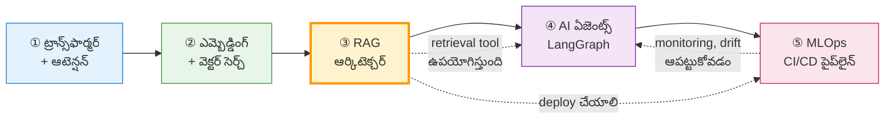

# 🎨 విజువల్ లెర్నింగ్ మెటీరియల్ (తెలుగు)

> **AI Engineering 40-Day Curriculum** — చిన్నప్పజులకు ఎంచుకున్న ముఖ్యమైన అంశాలకు
> **దృశ్య (visual) వివరణలు + డయాగ్రామ్‌లు + ఇంటర్వ్యూ ప్రశ్నలు + స్వీ-చెక్**

---

## 🗺️ ఈ సెట్‌లో ఏమి ఉంది?

| # | పాఠం | మూలం (Day) | ప్రధాన దృశ్యం | స్థాయి |
|:--|:--|:--|:--|:--|
| 01 | [ట్రాన్స్‌ఫార్మర్ & సెల్ఫ్-అటెన్షన్](01_Transformer_Attention_TE.md) | Day 20 | Q · K · V మూడు పాత్రలు, Multi-Head, Positional Encoding | L1–L3 |
| 02 | [ఎమ్బెడ్డింగ్ & వెక్టర్ సెర్చ్](02_Embeddings_Vector_Search_TE.md) | Day 26 | అర్థం → జ్యామితీ, Cosine vs L2, ChromaDB vs FAISS | L1–L3 |
| 03 | [RAG ఆర్కిటెక్చర్](03_RAG_Architecture_TE.md) | Day 27 | 7 దశలు, Chunking, Grounding, Hallucination నిరోధం | L1–L3 |
| 04 | [AI ఏజెంట్స్ & LangGraph](04_AI_Agent_LangGraph_TE.md) | Day 31 | State/Nodes/Edges, HITL, Circuit Breaker | L2–L4 |
| 05 | [MLOps CI/CD పైప్‌లైన్](05_MLOps_CICD_Pipeline_TE.md) | Day 34 | Champion–Challenger, Multi-stage Docker, Model Gate | L2–L5 |

---

## 🎯 ఈ మెటీరియల్ ఎలా ఉపయోగించాలి

1. **మొదట** ⚡ **శీఘ్ర దృశ్యం** (Quick View) చదవండి — ASCII ఆర్ట్, ఏదో గుర్తిపోతుంది.
2. **తర్వాత** 🗺️ **Mermaid డయాగ్రామ్** చదవండి — ఇది GitHub / VS Code / Obsidian లో render అవుతుంది.
3. **అప్పుడు** 🧠 **స్లోగానిక్** భాగం — ఉదాహరణతో బోధించుకోండి.
4. **చివరగా** ✍️ **స్వీ-చెక్** ప్రశ్నలకు సమాధానం ఇవ్వండి — **ముందు జవాబులు చూడకండి!**

> 🎯 **గుర్తుంచుకోండి:** స్వీ-చెక్ సమాధానాలు `<details>` బ్లాక్‌లో పెట్టబడ్డాయి — ముందు చూస్తే చెడ్డది!
> `<summary>` క్లిక్ చేస్తే అప్పుడు తెలుస్తుంది.

---

## 🧭 ప్రతి పాఠం ఏ ప్రాతిపదిక (Structure)

```
📘 పాఠం పేరు
│
├── 🎯 లక్ష్యాలు            — ఈ పాఠం తర్వాత మీరు ఏం చేయగలరు
├── ⚡ శీఘ్ర దృశ్యం          — ASCII ఆర్ట్ (ఏదైనా renderer లో పనిచేస్తుంది)
├── 🗺️ Mermaid డయాగ్రామ్      — రెండవ డైమెన్షనల్ రెండవసారు అదనపు వివరణ
├── 🧠 స్లోగానికి / ఉదాహరణ       — వాస్తవ జీవిత సమానాంతరం
├── 📊 పరిశీలనా పట్టికలు        — మెట్రిక్‌లు, పోలికలు, విషయాలు
├── 💻 ప్రాక్టికల్ కోడ్        — Framework లేకుండా / framework తో
├── ⚠️ వైఫల్యం ఎక్కడ జరుగుతుంది — సాధారణ తప్పులు + పరిష్కారం
├── 🎤 ఇంటర్వ్యూ ప్రశ్నలు        — సమాధానాలతో
├── ✍️ స్వీ-చెక్                — 5 ప్రశ్నలు (సమాధానాలు చివరలో)
└── 📚 తదుపరి అడుగులు           — సంబంధిత పాఠాలకు లింక్‌లు
```

---

## 🔗 సంబంధాలు — ఏది ఏది తర్వాత?



> 💡 **పరిశీలన:** ③ (RAG) → ④ (ఏజెంట్స్) సంబంధం అత్యంత ముఖ్యమైనది — modern AI agent లో **retrieval ఒక tool**. ⑤ (MLOps) మొత్తం chain ను production లో నిలుపుతుంది.

---

## 🖼️ డయాగ్రామ్‌లను ఎలా చూడాలి

| పరిస్థితి | ఏమి చేయాలి |
|:--|:--|
| **GitHub / GitLab** | మార్క్‌డౌన్‌లో Mermaid స్వయంగా render అవుతుంది — `.md` ఫైల్ తెరవండి |
| **VS Code** | "Markdown Preview Mermaid" extension ఇన్‌స్టాల్ చేసి preview ఓపెన్ చేయండి |
| **Obsidian** | Mermaid built-in — preview mode (`Ctrl/Cmd + E`) |
| **Notion** | `/code` బ్లాక్ → language "mermaid" |
| **మీరు చదవడం లేదు** | ప్రతి పాఠంలోని **⚡ శీఘ్ర దృశ్యం** ASCII ఆర్ట్ ఏదైనా సాధారণ ఎడిటర్‌లో కనిపిస్తుంది |
| **ప్రింట్ / PDF** | Mermaid బదిలు **ASCII ఆర్ట్‌ను** వాడండి, లేదా `make-pdf` స్కిల్ వాడండి |

---

## 🎨 దృశ్య రూపాలు (Visual Styles) ఇదే సెట్‌లో వాడబడినవి

| రూపం | ఎక్కడ వాడారు | ఏమి చూపిస్తుంది |
|:--|:--|:--|
| `flowchart TB` | ప్రధాన ఆర్కిటెక్చర్‌లు | పూర్తి data flow, ఎక్కడి నుండి ఎక్కడికి |
| `flowchart LR` | పోలికలు / ప్రక్రియలు | సమాంతరమైన ఎంపికలు |
| `sequenceDiagram` | HITL (గైడ్ 04) | మనిషి ఎప్పుడు ఆమోదిస్తాడు, ఎప్పుడు state ఆగుతుంది |
| `subgraph` | ఆఫ్‌లైన్ vs ఆన్‌లైన్ | సమయానుసారం విభజన |
| `style` | ప్రతి డయాగ్రామ్ | ✅ సరైనది / ❌ తప్పు / ⚠️ జాగ్రత్త — లోకుణాంతరం |

---

## 🧩 త్వరిత గుర్తుంచుకోవడానికి (Quick Memory Cues)

| పాఠం | ఒక్క వాక్యం |
|:--|:--|
| ① ట్రాన్స్‌ఫార్మర్ | **"Key అంటే పేరు, Value అంటే వస్తువు."** |
| ② ఎమ్బెడ్డింగ్ | **"Keyword search అక్షరాలను వెతుకుతుంది; Vector search భావాలను వెతుకుతుంది."** |
| ③ RAG | **"RAG = మోడల్‌కి ఓపెన్-బుక్ ఇవ్వడం."** |
| ④ ఏజెంట్స్ | **"LangChain = conveyor belt, LangGraph = ER flowchart."** |
| ⑤ MLOps | **"బెట్టర్ కోడ్ రాస్తే కాదు — బెట్టర్ గుర్తులు కొలిచి అప్పుడు అనుమతి ఇస్తాం."** |

---

## 📚 మూల కరెక్షర్‌తో పోలిక

| ఈ మెటీరియల్ | మూలం | తేడా |
|:--|:--|:--|
| `01_Transformer_Attention_TE.md` | `Module_04_AI_Machine_Learning/Day_20_Transformers_Modern_Models_TE.md` | ఇక్కడ **డై-గ్రామ్ + ఫోకస్** — పాఠ్యం కాదు |
| `02_Embeddings_Vector_Search_TE.md` | `Module_06_RAG_AI_Applications/Day_26_Embeddings_Vector_Search_TE.md` | ఇక్కడ **vector geometry దృశ్యీకరణ** |
| `03_RAG_Architecture_TE.md` | `Module_06_RAG_AI_Applications/Day_27_RAG_Architecture_TE.md` | ఇక్కడ **7-దశలు ఒక్క diagram లో** |
| `04_AI_Agent_LangGraph_TE.md` | `Module_07_Agentic_AI_MCP/Day_31_LangGraph_Agents_TE.md` | ఇక్కడ **HITL sequence diagram** |
| `05_MLOps_CICD_Pipeline_TE.md` | `Module_08_MLOps_LLMOps/Day_34_ML_Pipelines_CICD_TE.md` | ఇక్కడ **Champion–Challenger gate** |

> 💡 **ఉత్తమ విధానం:** మొదట ఈ విజువల్ గైడ్ చదవండి (30 నిమిషాలు), తర్వాత అసలు Day ఫైల్‌కు వెళ్ళండి — లోతైన వివరణలు, ప్రాక్టికల్ ల్యాబ్, మరిన్ని ఇంటర్వ్యూ ప్రశ్నలు అక్కడ ఉంటాయి.

---

## 🚀 తదుపరి అడుగులు

1. ✅ ఈ 5 పాఠాల **స్వీ-చెక్** ప్రశ్నలకు సమాధానాలు ఇవ్వండి (జవాబులు చూడకండి!)
2. 🔍 జవాబుల్లో గందరగోళం ఉంటే — ఆ పాఠంను **మళ్లీ** చదవండి
3. 🛠️ **హ్యాండ్స్-ఆన్ ల్యాబ్** — Day 27 (RAG), Day 31 (LangGraph), Day 34 (FastAPI serving) చేయండి
4. 🎤 ఇంటర్వ్యూ ప్రశ్నలకు **నిజమైన voice-లో** సమాధానాలు చెప్పండి

---

**📌 గమనిక:** ఈ డై-గ్రామ్‌లు Mermaid syntax లో ఉన్నాయి — వాటిని
[mermaid.live](https://mermaid.live) లో పేస్ట్ చేసి **SVG/PNG గా డౌన్‌లోడ్** చేసుకోవచ్చు.
మూల పాఠాలు → [AI_Engineering 40-Day Curriculum](../)
